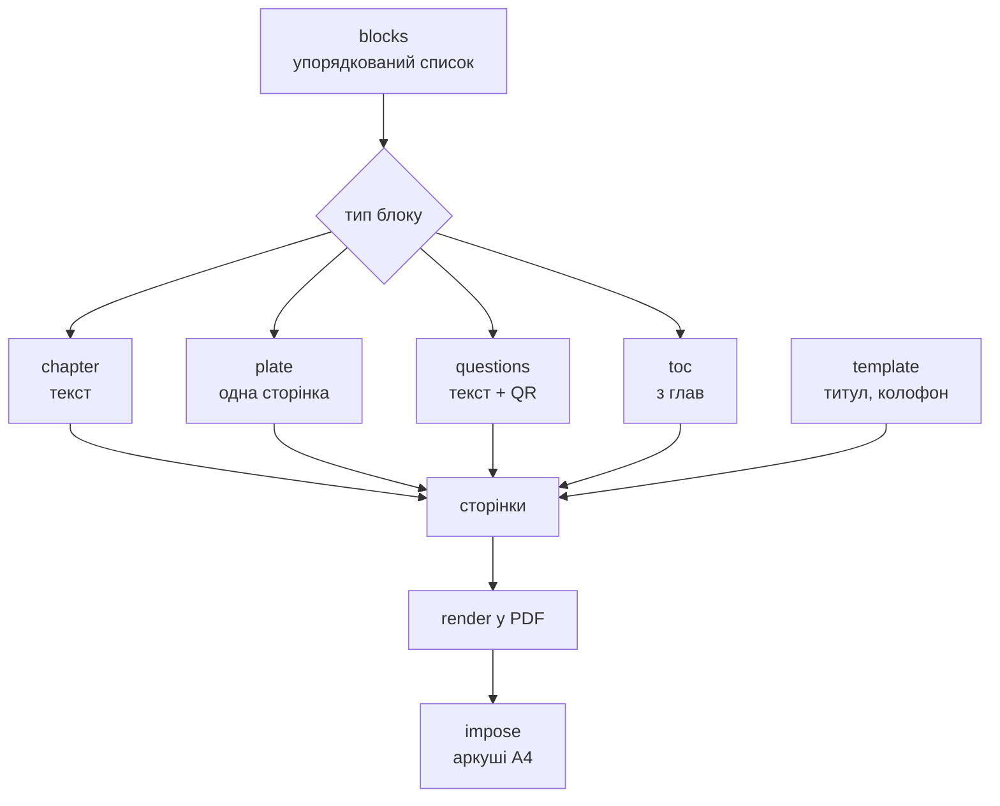

# FANCRAFT© — ТЗ

Sep 22, 2026 · @Someone

Браузерний редактор, що готує рукопис до друку на офісному Ч/Б лазері й ручного складання книги без обрізу. Без бази даних, без сервера.

## Технологічний стек

Усе виконується в браузері, без сервера й без бази даних. Бандл — близько 400 КБ плюс шрифт.

| Шар | Бібліотека | Чому саме вона |
| --- | --- | --- |
| Оболонка | Vite + React, PWA | статичний хостинг, десктоп і мобайл з однієї кодової бази |
| Редактор структури | Tiptap (ProseMirror) з урізаною схемою | семантичне дерево замість HTML; дозволено рівно ті вузли, що є в моделі |
| Метрики шрифту | fontkit | ширини гліфів і кернінг-пари для розбивки рядків |
| Переноси | hypher + словники uk, ru | єдиний спосіб отримати щільний набір на смузі 112 мм |
| Верстка | власний модуль | чиста функція, \~600–1000 рядків, без залежностей |
| PDF | pdf-lib | drawText, drawSvgPath, embedPage, сабсетинг шрифтів |
| QR | qrcode-generator → drawSvgPath | вектор замість растру |
| Архів проєкту | fflate | zip у кілька десятків кілобайт коду |
| Важкі обчислення | Web Worker | верстка й експорт не блокують інтерфейс |

### Чого свідомо не беремо

**Typst / LaTeX у WASM** — справжні рушії верстки, але кілька мегабайт бандла, чужа мова розмітки посередині пайплайну й ризик з пам'яттю на iOS. При фіксованій палітрі стилів їхня потужність не потрібна.

**Paged.js плюс браузерний «Друк у PDF»** — поля залежать від браузера, шрифти вбудовуються непередбачувано, iOS Safari не дає керованого експорту.

**Серверний рендер** — суперечить умові «без бази, у браузері» й тягне за собою хостинг, черги та ліміти.

**Будь-яку бібліотеку спуску** — потрібний випадок один і вміщується у два десятки рядків.

## Архітектура

Програма складається з **двох половин, які майже не знають одна про одну**.

| Половина | Що робить |
| --- | --- |
| **Редактор** | розмітка тексту по главах і блоках |
| **Видавець** | блоки → сторінки → аркуші → PDF |

Міст між ними один — кнопка «Експорт». Редактор нічого не знає про поля, кеглі, зошити й аркуші; видавець нічого не знає про інтерфейс. Поміж ними лежить модель, і більше нічого.

Звідси головний наслідок для розробки: редактор стає повністю робочим **до того, як з'явиться рушій верстки**. Щойно модель зафіксована, дві половини можна будувати в будь-якому порядку і не втручатись одна в одну.

Друга половина — чиста функція `блоки → PDF`. Усе нижче в цьому розділі стосується її.

Книжка — **один упорядкований список блоків**. Порядок у списку і є порядком у книжці. Прив'язок, якорів і посилань між блоками немає — ілюстрація стоїть там, де лежить у списку.



Кожен тип блоку має власну маленьку функцію `toPages(block) → Page[]`. Розбивач рядків у них спільний — і він, як і раніше, **не знає ні про зображення, ні про QR, ні про типи блоків**. Він міряє гліфи й повертає рядки; усе решта — обгортки навколо нього.

Додати п'ятий тип блоку пізніше означатиме одну нову функцію й один новий `case`. Це головна перевага списку перед потоком із якорями.

### Два наслідки, на яких тримається простота

**Прев'ю — це сам PDF.** Відмова від WYSIWYG знімає екранний рендерер цілком: готовий файл показується у вбудованому переглядачі через blob URL. Точність стовідсоткова, додаткового коду немає.

**Перерахунок не мусить бути миттєвим.** Верстка йде в воркері з дебаунсом 300 мс і індикатором. Це знімає вимоги до продуктивності рушія — його можна писати прямолінійно.

## Модель даних

Проєкт — список блоків, шаблон і короткий набір налаштувань. Жодне поле не описує вигляд сторінки.

```json
{
  "version": 1,
  "meta": { "title": "", "author": "", "year": "" },

  "settings": {
    "sheet": "A4",
    "font": "lora",
    "scheme": "medium",
    "sheetsPerSignature": 5
  },

  "blocks": [
    { "id": "b1", "type": "toc",
      "title": "Зміст" },

    { "id": "b2", "type": "chapter",
      "title": "День перший",
      "body": [
        { "type": "paragraph", "runs": [
            { "text": "", "b": false, "i": false, "s": false } ] },
        { "type": "heading", "runs": [] }
      ] },

    { "id": "b3", "type": "plate",
      "asset": "img/a7f3c1.jpg",
      "title": "",
      "caption": "",
      "side": "auto" },

    { "id": "b4", "type": "questions",
      "title": "Що спитати в цієї книжки",
      "items": [ "", "" ],
      "url": "https://…",
      "note": "" },

    { "id": "b5", "type": "tabula_rasa",
      "title": "",
      "count": 2,
      "side": "auto" }
  ],

  "template": {
    "titlePage": { "qr": { "url": "https://…", "size": 20 }, "photo": "img/img_001.jpg" }
  }
}
```

### Що тут важливо

Формат книжки **не зберігається**. Зберігається формат аркуша, а сторінка є рівно його половиною. Без обрізу інакше й бути не може.

Немає полів, інтерліньяжу, розмірів заголовків і розмірів ілюстрацій. Усе це похідне від формату та обраного кегля.

У блока немає номера сторінки й немає позиції — тільки місце в списку. Щоб пересунути ілюстрацію в інше місце книжки, достатньо перетягнути картку вище або нижче.

`id` у блока потрібен лише інтерфейсу — для ключів у списку та відміни дії. Модель на нього ніде не посилається.

## Типи блоків

Шість типів, кожен із власною `toPages`. Усі починаються з нової сторінки — блоки ніколи не ділять сторінку між собою.

| Тип | Вміст | Сторінок | Починається |
| --- | --- | --- | --- |
| `part` | назва (з номером) + опис + фото (необов'язкове) | рівно одна | з правої |
| `chapter` | назва + зображення (необов'язкове) + текст | скільки треба | з наступної |
| `plate` | заголовок + фото + опис | рівно одна | `side` |
| `questions` | заголовок + перелік + QR | 1–2 | з нової |
| `toc` | генерується з глав | 1–2 | з правої |
| `tabula_rasa` | нічого | `count` | `side` |

### part

**Частина** (розділ) — вищий рівень над главами: сторінка, що відкриває групу глав. Має номер і/або назву — усе в `title`, як у тексті: «Частина II. Невидимі», «Розділ перший», «Книга 1 — Третій шлях». Блок не «містить» глави: частина — просто рядок у списку, а глави після неї — наступні рядки до наступної частини. Поля: `title`, `description` (в інтерфейсі підписане «Підзаголовок»), `asset` (порожній — без фото).

Кілька частин можуть іти підряд без глав між ними — «Книга 1», «Том 2», «Частина 3», а вже потім глава. Це нормально: кожна — окрема права сторінка (між ними — порожні ліві). Рівнів частин у моделі немає: книга, том, частина, розділ — усі просто частини.

- Завжди з правої сторінки, рівно одна сторінка, без колонцифри. Наступна глава починається одразу з наступної сторінки (лівої).
- Фото не дрібніше за 150 dpi.
- Назва — **жирним**, кеглем `partTitle` зі схеми розмірів (більшим за назву глави), підзаголовок (опис) — кеглем основного тексту **жирним**. Усе по центру, на сітці рядків.
- **Оформлена як обкладинка, лише без автора й QR:** назва на третині смуги (з фото не рухається), підзаголовок через рядок; квадрат фото (`COVER_PHOTO_RATIO` ширини) — посередині між рядком підзаголовка (резервується й без нього) і низом смуги, з рівними відступами; фото вписується в квадрат по центру.
- Фото робить аркуш кольоровим, як полоса. Фото можна прибрати.
- У змісті частини — жирним, з номером своєї сторінки й порожнім рядком перед ними.

### chapter

**Глава — системна одиниця тексту: назва + текст.** Пролог, епілог, передмова, післямова, «Від автора» — теж глави. Власний внутрішній потік: лише абзаци й накреслення (жирний, курсив, перекреслення). **Підзаголовків немає** — для акцентів усередині глави є жирний. Правила верстки діють усередині блоку і ніколи не перетікають у сусідній.

**Усі назви — жирним**: назви глав, частин, змісту, питань і сторінок для нотаток — і в редакторі, і в PDF. **Кожна глава починається з назви** — з верху нової сторінки (правої чи лівої — як випаде), і йде у зміст. Назва може займати кілька рядків. Глава без назви (після розрізу, розбивки за мітками чи імпорту, у старих .book при відкритті) бере назвою **перше речення** свого тексту — до кінцевого . ! ? … з пробілом чи кінцем абзацу після нього, а без такого знака — перший абзац цілком; воно переходить із тексту в назву, решта абзацу лишається з накресленнями. Нова глава (з панелі «Додати» і перша глава нової книжки) — **з порожньою назвою**: на сторінці підказки «Назва глави» і «Текст глави»; уся сторінка порожньої глави клікабельна — курсор стає в текст. **Місце під назву є завжди**, і в порожньої назви (у PDF — порожнє місце): глава без назви й тексту не зникає з книжки — лишається сторінкою; прибирається лише хрестиком у структурі.

Глава не вставляє порожню сторінку, щоб потрапити на праву: книжка показується й друкується такою, як є, але кожна глава — з нової сторінки.

**Зображення глави** (`asset`, необов'язкове) — під назвою, по центру, у ширину смуги, не вище за половину смуги й не дрібніше за 150 dpi; текст починається через рядок під ним на тій самій сторінці. Робить аркуш кольоровим, як полоса.

Звідси береться **примусовий розрив сторінки**: «Розділити блок тут» ріже картку надвоє, друга половина — нова глава з наступної сторінки (назва — за правилом вище). Зворотної кнопки «Об'єднати з наступною» немає: текст переноситься між главами вирізанням і вставкою (Ctrl+X / Ctrl+V), порожня глава видаляється в структурі.

Окремого елемента «розрив сторінки» усередині тексту немає і не буде. Список блоків уже вміє все, що він робив би, а один такий елемент за рік притягне «а можна ще розрив без розриву».

### plate

Зображення завжди на цілу сторінку, без розміру. `side` — `auto` (найближча), `recto` або `verso`.

**Прив'язка до глави.** Ілюстрація одразу **під главою** у списку структури прив'язана до неї й стоїть **на розвороті з першою сторінкою глави** (з назвою): «ліворуч від назви» — ілюстрація, потім сторінка з назвою; «праворуч від назви» — сторінка з назвою, потім ілюстрація; «найближча» — одразу після сторінки з назвою (довга глава продовжується за ілюстрацією). Якщо розворот не складається (глава мала б початися не з того боку) — перед ними порожня сторінка (її можна зайняти, див. «Заброньовані порожні сторінки»). Коли вибрана ілюстрація, її глава в структурі трохи підсвічена. Ілюстрація **не під главою** (під частиною, змістом, іншим блоком) — на найближчій сторінці, **вибору боку немає** (поле неактивне). На полотні сторінка ілюстрації посеред глави — «дірка» в редакторі глави (`ChapterLayout.holes`), сама сторінка — поверх неї.

### questions

Перелік питань до книжки та QR, що веде на її **текст для ШІ**: читач сканує, завантажує текст у будь-яку модель і ставить ці або свої питання.

Звідси слідує новий вихід програми — **`book.txt`**, чистий текст книжки, зібраний із тих самих блоків. Програма готує його разом із PDF; куди його покласти й який URL вписати в `url` — справа користувача. Сервера це не потребує: програма лише малює код із вписаного посилання.

Це гарна річ: книжка виходить у двох тілах одночасно — паперовому й машинному, і друге не коштує нічого, бо текст уже є в моделі.

- **Завжди одна сторінка**, будь-де в книжці (на початку, посередині, в кінці). Назва, пронумерований перелік, примітка; унизу смуги — **місце QR, зарезервоване завжди** (як на обкладинці: екран і PDF однакові; сам QR — лише з посиланням).
- **Ліміт знаків**: рушій рахує, скільки знаків влазить у перелік і примітку над QR (рядки × ширина рядка); над сторінкою — лічильник «N / максимум знаків», набрати більше не можна. Що все ж не влізло (довгі пункти переносяться) — не друкується, над сторінкою попередження.
- **Пункти додаються** кнопкою «+ Пункт» над сторінкою або Enter у переліку: новий порожній пункт одразу видно рядком (порожні пункти на екрані лишаються, у PDF — ні).

### toc

Мітка місця, а не вміст. Зміст складається автоматично з заголовків `chapter` і їхніх номерів сторінок; вводити нічого не треба.

Оскільки зміст сам займає сторінки й тим зсуває нумерацію, яку показує, пагінація йде двічі: перший раз із зарезервованим місцем, другий — із підставленими номерами. Це єдине місце в програмі, де проходів два.

### tabula\_rasa

Навмисно порожні сторінки: щоб написати від руки, вклеїти знімок, лишити тиші між частинами.

| Поле | Значення |
| --- | --- |
| `count` | скільки сторінок; «+ Порожня» — завжди 1, «Для нотаток» — рівно на кількість вільних сторінок |
| `side` | завжди `auto` — найближча сторінка |
| `title` | необов'язковий, друкується лише на першій |

**«Вільна» (раніше «Порожня») — одна сторінка на найближчому місці**: без вибору кількості й боку, лише необов'язкова назва. **«Для нотаток»** — теж одна сторінка (`tabula_rasa` з `ruled`), з назвою «Для нотаток» і **лініями** по базових лініях рядків сітки під місцем назви — тонкими сірими, у PDF і на екрані; додається будь-де; у структурі — тип «Нотатки».

Колонцифра на них не друкується — на цих сторінках пишуть. Римська позначка лишається: вона належить аркушу, а не вмісту.

**Два різні види порожнечі.** Пагінація й сама вставляє порожні сторінки — щоб розділ почався з правої, щоб добити останній зошит до повного (вільні сторінки). Ті не існують у моделі й з'являються при розрахунку. `tabula_rasa` — блок, який поставили ви.

На папері вони однакові, але в статистиці книги рахуються окремо: «6 порожніх, з них 2 навмисні». Інакше неможливо зрозуміти, чи все гаразд із версткою.

Розлініювання поки не робимо. Тонкі сірі лінії лазер віддає растром і вони стають брудними, а чорні 0,25 pt надто голосні для сторінки, де пишуть від руки. Якщо знадобиться — це одне поле `guide` і десяток рядків, але спершу варто спробувати чистий аркуш.

## Формат, геометрія та типографіка

Аркуш складається навпіл одним фальцем. Сторінка дорівнює половині аркуша, поля — 9 % ширини сторінки з усіх боків (`MARGIN_RATIO`): вужчі поля — більше тексту на сторінці й менше зошитів.

| Аркуш | Сторінка | Поля | Смуга | Кегль / інтерліньяж (дефолт) | Знаків у рядку |
| --- | --- | --- | --- | --- | --- |
| A3 | A4 | 18,9 мм | 172 × 259 мм | 13 / 17 pt | \~62 |
| **A4** | **A5** | **13,4 мм** | **122 × 183 мм** | **11 / 14,5 pt** | **\~52** |
| A5 | A6 | 9,5 мм | 86 × 129 мм | 9 / 12 pt | \~45 |

Реально тестується й підтримується лише шлях **A4 → A5**. Інші два лишаються в пресетах, бо коштують по три числа: A6 вимагає подачі A5, на якій більшість офісних лазерників жує папір, A4 — A3-принтера.

### Шрифт і кегль

**Гарнітура одна — IBM Plex Mono** (друкарська машинка): повна кирилиця, чотири накреслення, OFL. Вибору гарнітури немає ні в інтерфейсі, ні в `settings`; поле `font` зі старих `.book` при відкритті відкидається. Розмір — схема розмірів (великий, середній, малий), єдиний типографський вибір у книжці.

- чотири накреслення: пряме, напівжирне, курсив, напівжирний курсив. Перекреслення малюється лінією;
- моноширинна гарнітура: кожен знак однакової ширини, тож кількість знаків у рядку залежить лише від формату й розміру.

Від обраного кегля **похідне все інше**: інтерліньяж 1,32 × кегль, розміри заголовків як множники, усі вертикальні відступи в рядках. Одне число задає весь ритм книжки.

Поруч із вибором кегля показується наслідок — скільки знаків лягає в рядок. 11 pt на A5 дає \~52, 13 pt — \~44. Це не попередження, а число, яке видно під час вибору.

Шрифт іде разом із програмою й в архів проєкту не копіюється. Один і той самий файл TTF використовується і для вимірів через fontkit, і для вбудовування в PDF — інакше метрики екрана й друку розійдуться.

### Емодзі

Друк чорно-білий, тож емодзі в книжці — **чорно-білі контури** шрифту Noto Emoji (монохромний, OFL). Він — запасний шрифт: знак, якого немає в гарнітурі книжки, малюється ним; решта тексту — гарнітурою.

- Текст рядка ділиться на фрагменти за наявністю гліфа: гарнітура або емодзі. Селектори варіанта, тони шкіри й ZWJ-послідовності лишаються в одному фрагменті з емодзі — шрифт складає з них один гліф (👍🏽, 👨‍👩‍👧, 🇺🇦). Тон шкіри на папері не видно.
- Ширини рахуються тим самим шрифтом, що й малюються, — як для гарнітури.
- У PDF вбудовується підмножина лише використаних гліфів і лише тоді, коли в книжці є емодзі.
- Редактор показує емодзі тим самим шрифтом, тобто так, як вони надрукуються, а не кольоровими системними.

Окремий конфіг `src/emojiConfig.ts`:

| Що | Навіщо |
| --- | --- |
| основні емодзі за групами (знаки, обличчя, руки, природа, речі) | їх пропонує панель емодзі; лише вони лишаються при імпорті |
| заміни варіантів на основні | кольорові серця → ❤, ✅ → ✔, 😁 → 😀 тощо: на чорно-білому папері вони однакові. ★ ✦ ♪ ♡ за Unicode не емодзі, але їх немає ні в IBM Plex Mono, ні в Noto Emoji — теж замінюються на найближчий знак (⭐ ✨ 🎵 ♥). ✓ і ❌ є в IBM Plex Mono |

Панель емодзі — кнопка ☺ у панелі інструментів редактора глави; у панелі — основні емодзі за групами. **Поруч із кнопкою ☺ — три швидкі емодзі:** найчастіші в книжці; якщо їх менше трьох — ❤ 🔥 😊. Знак вставляється туди, де стоїть курсор: у текст глави, її назву чи поле сторінки; після вибору панель закривається.

### Вертикальний ритм

Усі вертикальні відступи задаються **в рядках, не в міліметрах**. «Заголовок — два рядки згори, один знизу» працює на всіх форматах без перерахунку.

Між абзацами тексту глави — **пів рядка** (`PARAGRAPH_SPACE`), разом з абзацним відступом: текст не зливається. Нагорі сторінки проміжку немає; у переліку питань — теж. Це єдиний відступ не на цілий рядок: після нього рядки зсуваються з базової сітки на півкроку, на сторінку влазить лише ціла кількість рядків.

Наслідок — базова сітка з'являється сама: на просвіт рядки лиця й звороту лягають один в один. На тонкому офісному папері це помітно.

## Правила пагінації

Усі правила працюють мовчки. Програма нічого не питає й ні про що не попереджає.

| Ситуація | Дія |
| --- | --- |
| Початок розділу | з нової правої сторінки; порожня ліва вставляється за потреби |
| Менше двох рядків абзацу на сторінці | сторінка закінчується на рядок раніше |

Перші два правила можливі тому, що низ смуги не мусить збігатися на всіх сторінках. Класична верстка воює з висячими рядками складними засобами саме через це обмеження; тут його немає.

### Один прохід, без ітерацій

Вставка полоси або порожньої сторінки зсуває все наступне й може перекинути наступний розділ з правої на ліву. Наївна реалізація тут або зациклюється, або дає помилку на одиницю.

Рішення: **один прохід від початку до кінця з лічильником сторінок.** Кожен елемент приймає рішення, знаючи лише поточну парність, і ніколи не переглядає попередні. Вставки тільки додають уперед, тож збіжність гарантована.

### Зміст

Зміст генерується після пагінації з назв частин і глав — вводити нічого не треба. Частини — жирним, з порожнім рядком перед ними. Переліку ілюстрацій немає.

Сам зміст займає сторінки й тому впливає на нумерацію, яку сам показує. Тому пагінація йде двічі: перший раз з зарезервованим місцем під зміст, другий — з підставленими номерами. Це єдине місце, де проходів два.

## Ілюстрації

Ілюстрація завжди займає **цілу сторінку**. У неї немає розміру, масштабу й обтікання — це три поля, яких немає ні в моделі, ні в інтерфейсі.

Без обтікання верстка лишається одним лінійним проходом. Це не естетичний компроміс, а несуча конструкція: обтікання перетворює розбивку на задачу зі зворотним зв'язком.

### Розміщення

| Поле | Значення |
| --- | --- |
| місце | позиція картки в списку блоків |
| `side` | `recto` — завершує прочитане; `verso` — відкриває наступне; `auto` — найближча вільна |

Зображення вписується в смугу по більшій стороні, в ті самі поля, що й текст. Зображення «під зріз» неможливе: без обрізу лишиться нерівна біла смуга недрукованої зони принтера.

Але є стеля збільшення — **не більше 200 %**, тобто не нижче 150 dpi на відбитку. Якщо вписування в смугу опустило б роздільність нижче, зображення друкується меншим і **центрується на сторінці**.

Фото на 300 px: повна смуга вимагала б ≈660 px, тож воно ставиться на 200 % — 50,8 мм завширшки — і стоїть посеред сторінки.

Пікселі при цьому **не домальовуються**. Файл лишається на 300 px, змінюється лише розмір, у якому він покладений на сторінку. Інтерполяція не додала б жодної деталі, а вагу збільшила б учетверо.

Мала світлина посеред великої сторінки читається як наклеєний відбиток — для рукотворної книжки це гідний вигляд, а не аварійний режим. Підпис під нею тримає ширину зображення, але не вужче половини смуги (56 мм).

Центрування **оптичне**: блок піднімається на 2–3 % висоти смуги вище геометричного центру. Піднімається саме композиція «зображення + підпис», а не зображення окремо.

### Підпис

Заголовок і опис необов'язкові.

- ширина підпису = ширина зображення, не смуги;
- вирівнювання по лівому краю зображення — обидва, без винятків;
- заголовок — кегль тексту, напівжирний; опис — на 2 pt менше, курсив;
- між зображенням і заголовком — один рядок, між заголовком і описом — нуль.

Якщо композиція не влізає — **зменшується зображення, ніколи не текст**. Рушій для цього викликає той самий розбивач рядків на вужчій колонці; нової машинерії не потрібно.

### Вставка з буфера

Зображення можна не лише вибрати файлом, а й **вставити з буфера** (Ctrl+V) — скриншот, картинку, скопійовану з браузера чи редактора. Обробка та сама, що при виборі файлу (зменшення до ширини з конфігу, `img/img_NNN` по порядку).

- Фокус на місці зображення (ілюстрація, частина, обкладинка, зображення під назвою глави) — Ctrl+V ставить зображення туди, замінюючи наявне.
- Курсор у тексті глави — Ctrl+V із зображенням у буфері створює блок «Ілюстрація» **одразу після цієї глави**: у текст глави картинки не вставляються.
- У буфері і текст, і зображення (копія з веб-сторінки) — вставляється текст, як зараз.

### Вимоги до файлів

При імпорті зображення **зменшується до 2000 px по ширині**, якщо воно більше. Це єдина обробка в програмі.

| Крок | Значення |
| --- | --- |
| Зменшення при імпорті | до 2000 px по ширині |
| Повна смуга A5 | ≈1330 px = 300 dpi |
| Поріг центрування | ≈660 px = 150 dpi |
| Стеля збільшення | 200 % |

2000 px із запасом покривають повну смугу: на 112 мм це понад 450 dpi — більше, ніж лазер відтворює. Запас лишається на формат A4.

Зменшення означає перекодування, тож у програмі з'являється одна цифра — **якість JPEG 0,9**. Вище — марно, нижче — видно на великих рівних тонах. Робиться через `canvas.drawImage` і `toBlob` — п'ятнадцять рядків, без бібліотек.

Колір, контраст і гамма не чіпаються. У сірий переводить драйвер принтера при друці. Готувати світлину — справа користувача, до імпорту.

## Службові елементи сторінки

Нижня лінія сторінки несе два елементи на одній базовій лінії, близько 9 мм нижче смуги. Верхнього колонтитула немає.

|  | Ліва сторінка | Права сторінка |
| --- | --- | --- |
| Зовнішній край | колонцифра | колонцифра |
| Внутрішній край | — | римська позначка |

Обидва вирівняні по межах текстової смуги, а не по краю паперу. Тому зсув дуплексу на них не впливає: смуга зсувається ціликом разом із ними.

### Колонцифра

9 pt, та сама гарнітура, мінускульні цифри якщо є.

Не друкується на: полосних ілюстраціях, порожніх сторінках, титулі, колофоні, першій сторінці розділу. Але **нумерація їх рахує** — це має бути в рушії явно, інакше помилка вилізе аж на друці.

### Римська позначка аркуша

Одна позначка на один аркуш друку, тільки з лицьового боку, тільки на правій половині. Це технологічна інформація для ручного складання, і вона не ховається.

Формат: **зошит · аркуш**, обидва римські, розділені середньою крапкою.

```
I · I     I · II     I · III     I · IV     I · V
II · I    II · II    …
```

Умова друку для сторінки `p` всередині зошита з `S` аркушів:

```
друкувати, якщо  p непарна  і  p ≤ 2S−1
номер аркуша = (p+1)/2
```

Правий бік лиця — завжди непарна сторінка з першої половини зошита. Тому окремого шару рендеру не потрібно, а дзеркалення позиції відпадає.

При 5 аркушах позначки лягають на сторінки 1, 3, 5, 7, 9 кожного зошита. Це нерівномірно за визначенням: лице аркуша завжди містить одну сторінку з початку зошита й одну з кінця.

**Набір.** Номер зошита — 9 pt, номер аркуша — 7 pt, на всю позначку розрядка близько 5 %. Різниця кеглів розводить `I · II` і `II · I`, які інакше дзеркаляться — а це найймовірніша помилка при складанні. Вага також збігається з порядком роботи: спершу знайти зошит, потім аркуш у ньому.

Сірим не друкувати: дрібний сірий текст лазер відтворює растром і він стає брудною плямою.

## Титул, колофон і QR

Це не частина списку блоків: титул завжди перша сторінка книжки. **Копірайт (колофон) — необов'язковий, один на книжку** (`book.copyright`: `none` / `front` / `back`): його додає автор кнопкою «+ Копірайт» за потреби — у самвидаві автор і так на обкладинці. Додали одразу після титульної (або на порожню с. 2) — він стає на **с. 2** (зворот титулу); інакше — на **останню сторінку книжки**. Прибирається хрестиком у структурі. Нова книжка — без копірайту; у старих .book поля немає — копірайт лишається в кінці, як був. Редагуються просто на своїх сторінках у полотні книжки. Лого немає (прибране повністю; зі старих .book відкидається разом із `vec/`).

### Обкладинка (титул)

Титул — перша сторінка книжки, тобто її обкладинка; друкується завжди на с. 1. Поля: автор, назва, **підзаголовок** (`meta.description`), **фото обкладинки** (`template.titlePage.photo`, img/…) і **QR книжки** (`template.titlePage.qr`). Підзаголовок, фото й QR необов'язкові. Року й копірайту на обкладинці немає — «© рік» лише на колофоні.

- Автор — **жирним** угорі смуги, прив'язаний до її верху: над ним `COVER_AUTHOR_GAP` (1) порожній рядок.
- Назва — на третині смуги (не нижче за автора з пропуском `COVER_TITLE_BEFORE`), **незалежно від фото**: із завантаженим фото назва не рухається. Підзаголовок — **жирним**, через рядок під назвою.
- **Місце фото — квадрат** зі стороною `COVER_PHOTO_RATIO` (0,55) ширини смуги набору, по центру по горизонталі; по вертикалі — посередині між підзаголовком і місцем QR, з рівними відступами зверху й знизу (не менше рядка). Рядок підзаголовка резервується й без підзаголовка — квадрат не стрибає. Якщо назва чи підзаголовок довгі й місця бракує — квадрат менший, але квадрат. Місце рахує рушій (`page.photoZone`), екран показує заглушку (невелика іконка тонкою лінією) рівно там. Завантажене фото **вписується** в квадрат зі своїми пропорціями, по центру; не дрібніше за 150 dpi (дрібне не збільшується).
- **Місце QR резервується завжди** — є посилання чи ні: без QR фото в PDF стоїть там само, де на екрані.
- **Пробіли в полях** (обкладинка, назви, підписи, назва глави): коли поле втрачає фокус, пробіли на початку й у кінці рядка та подвійні прибираються — інакше рядок по центру стоїть криво; під час набору не чіпаються. Так само — при відкритті .book. У PDF рушій і так не друкує зайвих пробілів.
- Поле посилання для QR на екрані стоїть на місці самого QR (нижче, з відступом від фото); після введення й втрати фокусу замість поля — сам QR.
- QR — по центру внизу смуги. Розмір — `COVER_QR_SIZE` (11,2 мм) з конфігу; розмір, збережений у .book, не діє.
- Рік друкується копірайтом «© 2026» лише на колофоні. У `meta.year` — лише рік; знак, уписаний людиною, не подвоюється.
- **Сторінка копірайту (колофон):** унизу смуги по лівому краю — назва, автор, © рік; між полями відступ `COLOPHON_FIELD_GAP` (пів рядка), щоб вони не зливались. **Угорі зліва — довільний текст** (`meta.colophon`, необов'язковий): анотація, оригінальна назва, подяки, вихідні дані. Багаторядковий: абзац — з нового рядка, порожній рядок лишається. Що не влазить над полями (з порожнім рядком між ними) — не друкується.
- У структурі обкладинка — рядок «Титульна сторінка».
- Фото робить аркуш кольоровим. Фото можна прибрати — файл видаляється з проєкту.

### QR

QR є лише на обкладинці й на сторінці питань; на колофоні його немає. Зберігається **URL і розмір, не картинка**. Код генерується при експорті векторно — модулі як прямокутники.

Три наслідки: код ідеально чіткий за будь-якого розміру; у проєкті лежить двадцять байтів замість файлу; посилання можна виправити, не перемальовуючи.

### Назва та знак

Проєкт називається **FANCRAFT©** — мала «s» наприкінці замальована знаком копірайту. Простим текстом — імена файлів, заголовок вікна, manifest PWA — пишеться `FANCRAFTs`.

Це знак програми, не книжки: у видання він не потрапляє.

### Складальний аркуш

Окрема сторінка **поза книжкою**, друкується першою за бажанням: формат, кількість аркушів, кількість зошитів і щільність паперу, розклад зошитів із римськими позначками, кольорові аркуші. Виводиться з моделі, вводити нічого не треба.

## Зошити та режими експорту

Один фальц, дві сторінки A5 на альбомній A4, без повороту на 180°.

### Порядок сторінок

Для зошита з `N` сторінок, аркуш `i` (з нуля):

```
лице:   [ N − 2i , 1 + 2i ]
зворот: [ 2 + 2i , N − 1 − 2i ]
```

Це весь спуск. Міток різу, bleed, ліній фальцу немає — книжка не обрізається, а ручне складання «край до краю» точніше за складання по надрукованій лінії.

### Роздільник зошитів

**Зошити завжди повні.** Кількість аркушів у зошиті задає папір (див. «Панель книжки»), і всі зошити книжки однакові — зокрема останній. Зошитів стільки, скільки треба, щоб умістити всі сторінки.

Те, що текст не заповнив в останньому зошиті, — **вільні сторінки**. Вони стоять у кінці книжки — перед копірайтом, якщо він останній. Структура показує їх окремим рядком унизу з діапазоном сторінок і пропонує заповнити: блоком питань, сторінками для нотаток (`tabula_rasa` рівно на кількість вільних) або будь-яким іншим блоком. Не заповнені — друкуються порожніми.

Приклад: 106 сторінок по 5 аркушів → 6 зошитів по 20 сторінок = 120, вільних 14.

### Три режими — одна функція

Порядок сторінок рахується один раз, різниця лише в групуванні.

| Режим | Вихід | Групування |
| --- | --- | --- |
| Дуплекс | один PDF | Л0, З0, Л1, З1, … |
| Двопрохідний | два PDF | Л0, Л1, … і З0, З1, … |
| Чернетка | один PDF | спуск вимкнено, порядок читання |

У двопрохідному — тумблер «зворотний порядок зворотів» (залежить від того, чи принтер складає стос лицем догори чи донизу) і тумблер «зворот повернутий на 180°». Обидва — по одному `.reverse()`, і обидва економлять пачку паперу на здогадки.

Чернетка обов'язкова: вичитувати текст за зошитним порядком неможливо. Римські позначки в ній не друкуються — там немає аркушів.

Поруч із PDF експорт віддає **`book.txt`** — чистий текст книжки для ШІ, зібраний із тих самих блоків: заголовки глав, текст, підписи до ілюстрацій. Без верстки, без номерів сторінок, без переносів.

### Кольорові аркуші окремо

Блок друкується Ч/Б на лазері, а сторінки з ілюстраціями — на кольоровому принтері. Тому експорт віддає **два PDF замість одного**.

Ділити доводиться не сторінками, а **аркушами**: на одному A4 лежать чотири сторінки книжки, і якщо хоч одна з них — полоса, увесь аркуш йде в кольоровий друк. Текст на ньому надрукується теж кольоровим принтером — він чорний, тож виглядає нормально.

| Файл | Що всередині |
| --- | --- |
| `book-mono.pdf` | аркуші без жодної ілюстрації |
| `book-color.pdf` | аркуші, де є хоч одна |

Об'єднання двох файлів — уся книжка, перетину немає.

**Тут окупається римська позначка.** Аркуші з двох стосів складаються в один за номерами: I, II — з лазера, III — з кольорового, IV, V — знову з лазера. Без позначок два стоси довелося б зводити вручну, розглядаючи вміст.

Кількість кольорових аркушів видно в статистиці й вона оновлюється, щойно ви пересуваєте ілюстрацію або міняєте `side`. Дві полоси іноді потрапляють на один аркуш — тоді кольорових аркушів на один менше. Це видно одразу, і цим можна керувати.

Режим друку — дуплекс чи двопрохідний — застосовується до обох файлів однаково: кольоровий аркуш теж має зворот.

Дві практичні речі. Папір має бути один і той самий для обох стосів, інакше блок відчувається нерівним на дотик. І струминний принтер на звичайному офісному папері жолобить аркуш — без обрізу це помітно посеред зошита, тож варто взяти щільніший папір на всю книжку, а не лише на кольорові аркуші.

У налаштуваннях експорту — тумблер «розділити кольорові аркуші». Вимкнений — один файл, як досі.

### Друк

У PDF ставиться `/PrintScaling /None`, а в інтерфейсі експорту — явне нагадування друкувати в фактичному розмірі. Найчастіша причина зіпсованого зошита — драйвер у режимі «Вписати на сторінку».

Невелика зміна масштабу не критична: драйвери масштабують відносно центру аркуша, тож фальц лишається по центру. Звідси жорстке правило для рушія: **нічого не позиціонувати від краю аркуша** — усе від центру та від меж смуги.

Зсув дуплексу 0,5–1,5 мм приймається як допустимий: при полях 18 мм він не читається. Калібрування не потрібне.

Повзучість (creep) — **завжди нуль**. Компенсація має сенс лише перед обрізом; без гільйотини вона зсуне текст і лишить сходинку на передньому краї на місці. База відліку — лінія фальцу.

## Імпорт тексту

Розмітка тексту по главах — головний функціонал редактора. Сценаріїв два.

### Сценарій 1 — автор складає книжку сам

«+ Глава» у структурі, текст вставляється у праве вікно. Розбивати нічого не треба — структура з'являється разом із текстом.

### Сценарій 2 — приходить готовий текст

`.docx`, `.md`, `.txt`, `.pdf` або вставка з буфера. Програма розбиває текст на **частини й глави** сама; що не вийшло — лагодиться руками.

Нагорі — один рядок:

```
Розбивка: [Заголовки документа ▾] · 12 глав, 3 частини, 8 ілюстрацій    ☑ частини  ☑ ілюстрації окремими сторінками
```

Способів два, і третій — коли нічого не знайдено:

| Спосіб | Для чого |
| --- | --- |
| **Заголовки документа** | `.docx` (стилі Heading / Заголовок), `.md` (`#`) |
| **За ключовими словами** | будь-який текст: «Глава N», «Частина N», «Пролог»… |
| одна глава | нічого не знайдено — увесь текст одна глава, без окремого пункту |

Програма вибирає сама: є заголовки документа — їх; інакше ключові слова, якщо знайдено щонайменше 2 межі; інакше одна глава. Рядок дозволяє перемкнути. Старі зразки (мітки `###`, розриви сторінок, самі номери, `* * *`, ВЕЛИКІ ЛІТЕРИ, короткі рядки, «кожні N знаків») з імпорту прибрано — вони давали більше хибних меж, ніж справжніх.

#### Заголовки документа

- **Рівень заголовка не аналізується** (Heading 1 чи 2 — байдуже): у документах його часто ставлять як заманеться. Усі заголовки — кандидати в межі.
- Заголовок із ключовим словом **частини** — частина; інакше — глава.
- Якщо серед заголовків є щонайменше 2 з ключовим словом **глави** (або назвою без номера на кшталт «Пролог»), межами стають **лише заголовки з ключовими словами** (глави й частини); решта заголовків — жирні абзаци всередині глав. Так «Вкладка 63», «NETFLIX» у документі з «Глава 1…12» не стають главами.
- Інакше кожен заголовок — глава (або частина за ключовим словом).
- **Зміст самого документа** пропускається: заголовки підряд без тексту між ними не дають порожніх глав (крім частин — кілька частин підряд допустимі), рядки з номером сторінки в кінці («Глава 3 ........ 27») — не межі.

#### За ключовими словами

Межа — рядок, що:
- стоїть **окремим абзацом** — у середині абзацу «глава», «частина», «сцена» ігноруються, як і зараз;
- короткий (до ~80 знаків);
- починається з ключового слова (регістр неважливий, «ГЛАВА 3» теж);
- для глави: за словом — **номер** (арабські, римські, словом); для частини: номер **або назва** до крапки.

Назва — як у тексті: «Глава 3. Шторм» (після `. : — – -` у тому самому рядку або наступним коротким рядком — тоді склеюється через крапку). Самі номери без ключового слова («3», «III», «— 3 —») — не межі, якщо це не заголовок документа.

**Глава:**

| | Українська | Англійська | Російська |
| --- | --- | --- | --- |
| з номером | глава, гл. | chapter, ch., chap. | глава, гл. |
| без номера | Пролог, Епілог, Передмова, Вступ, Післямова, Від автора, Інтерлюдія, Подяки | Prologue, Epilogue, Preface, Foreword, Introduction, Afterword, Author's note, Interlude, Acknowledgements | Пролог, Эпилог, Предисловие, Введение, Вступление, Послесловие, От автора, Интерлюдия, Благодарности |

**Частина** (розділ):

| Українська | Англійська | Російська |
| --- | --- | --- |
| частина, розділ, книга, том | part, book, volume | часть, раздел, книга, том |

«Розділ» / «раздел» — частина, якщо в тексті є ще й глави (ключове слово «глава»/«chapter»); якщо глав немає — «розділ» стає главою, інакше вийшли б частини без жодної глави.

Прапорець «частини» вимкнено: якщо в тексті є глави, рядки частин лишаються звичайним текстом усередині глав; якщо глав немає — частини стають главами.

**Номер:** арабські (1–999), римські (I–C), словом — жіночий рід (глава, частина, книга): перша, друга, третя … двадцята / первая … двадцатая; чоловічий (розділ, том): перший, другий, третій … / первый, второй …; англійською One … Twenty, First … Twentieth. Порядок і зворотний: «Перша глава», «Частина перша».

**Послідовність:** номери глав ідуть по порядку (після нової частини рахунок може початися з 1). Номер «не на своєму місці» — не межа: найімовірніше, цитата чи перелік.

#### Текст до першої межі

Усе, що стоїть до першої межі (назва книжки, автор, епіграф, вступ без назви), — **на початок першої глави**, як є: звідти його зручно вирізати й вставити куди треба. На обкладинку нічого не переноситься.

#### Частина: опис

Текст між назвою частини й першою главою: до ~300 знаків — в **опис частини**; довший — окрема глава з назвою частини.

#### Ілюстрації окремими сторінками ⭐

- `.docx` — картинки лежать у файлі (`word/media`), відоме їхнє місце в тексті. `.md` — лише вбудовані (data URI). `.pdf` — якщо технічно вдається витягти зображення сторінки через `pdf.js` (растрові картинки); не вийшло — без них, текст імпортується все одно. `.txt` — картинок немає.
- Кожна картинка — блок «Ілюстрація» з тією самою обробкою, що при звичайному додаванні (зменшення до ширини з конфігу, `img/img_NNN` по порядку).
- **Підпис** — абзац одразу під картинкою, якщо він має стиль «Caption / Название объекта / Підпис» або починається з «Рис.», «Мал.», «Fig.», «Рисунок»; інакше підпису немає.
- **Дрібне пропускається**: значки, лінії, картинки-емодзі — менше ~300 px або вужче за третину смуги при 150 dpi.
- Перша картинка одразу під назвою глави — **зображення під назвою глави**, а не окрема сторінка.
- Картинка посеред глави — ілюстрація **одразу після цієї глави**; кілька — підряд, у тому ж порядку. Вставка ілюстрації всередину глави (на наступну сторінку після місця в тексті) — окрема задача на потім.

### Розрив глави в тексті

Якщо розбивка не підійшла, глави ріжуться руками прямо в текстовому вікні:

| Дія | Коли зручно |
| --- | --- |
| **Розділити тут** — по курсору, миттєво | кілька правок |
| **Розбити за мітками** — ставите `###` скрізь, потім одна дія | книжка на 200 сторінок |

Зворотної кнопки немає: зайве між главами переноситься вирізанням і вставкою (Ctrl+X / Ctrl+V), порожня глава видаляється в структурі.

Перший рядок після розрізу стає назвою, якщо він короткий і стоїть окремо. Інакше назвою стає перше речення глави. Невдале автовизначення дає не помилку, а назву, яку легко виправити на сторінці.

### Що чистить імпорт

- усі інлайнові стилі, крім bold / italic / strike — жирний і курсив з документа зберігаються;
- заголовки документа, що не стали межею глави чи частини, — жирні абзаци;
- порожні абзаци, подвійні пробіли, табуляції, пробіли на кінцях рядків;
- м'які переноси й ручні розриви рядків — переноси рахує рушій;
- лапки й тире нормалізуються до типографських;
- емодзі: основні з `emojiConfig.ts` лишаються, варіанти замінюються на основні, решта прибирається разом із зайвим пробілом. Типографські знаки ©, ®, ™, стрілки — не емодзі й не чіпаються.

Окремо про PDF: `pdf.js` віддає найбрудніший текст із усіх джерел — колонтитули, номери сторінок, переноси на кінцях рядків. Імпорт має викидати рядки, що повторюються на багатьох сторінках, і самотні числа. Навіть тоді PDF завжди вимагатиме ручної правки.

Google Docs — через експорт у `.docx` або звичайне копіювання. Прямий доступ потребував би сервера.

## Інтерфейс

Угорі — панель книжки: налаштування й статистика (див. нижче). Під нею два вікна: ліворуч — структура, праворуч — полотно книжки (див. «Полотно книжки»).

| Вікно | Що в ньому |
| --- | --- |
| **Структура** | упорядкований список блоків: частини, глави, ілюстрації, питання, зміст, порожні |
| **Полотно** | уся книжка сторінками там, де вони друкуватимуться: текст і зображення змінюються просто на сторінках |

Рядок структури несе тип, заголовок і — щойно з'явиться рушій верстки — діапазон сторінок:

```
Глава        День перший           с. 24–38
Ілюстрація   Причал                  с. 39
Глава        (без назви)            с. 40–46
Порожня      (без назви)             с. 47
─────────────────────────────────────────────
Вільні сторінки  6 сторінок         с. 49–54
Копірайт     © 2026                  с. 56
```

**У структурі — усі сторінки книжки по порядку**, і технічні теж: «Титульна» (с. 1; поруч назва книжки, без неї — «(без назви)»), блоки, **порожні сторінки, які вставила верстка** (рядок «Вільна · від верстки» там, де вона стоїть, — наприклад, щоб частина почалася з правої), «Вільні сторінки» (не блок — вільні сторінки останнього зошита, див. «Роздільник зошитів»), **«Копірайт»**, якщо доданий, — на своєму місці: одразу після титульної (с. 2) чи останнім (колофон: назва, автор, © рік; клік — перехід до нього, ✕ — прибрати). **Заброньовані порожні сторінки.** Порожню ліву, яку верстка вставила перед частиною чи змістом (чи перед ілюстрацією з вибраним боком), можна зайняти: клік по рядку «Вільна · від верстки» веде до неї, а на ній самій — кнопки «Додати» з підказкою «Ліва сторінка вільна — можна зайняти її однією сторінкою». Доданий блок стає рівно на неї (перед наступним блоком). Активне лише те, що займе одну ліву сторінку й не зсуне наступну частину чи зміст: **Ілюстрація**, **Питання** (завжди одна сторінка), **Вільна** (з назвою — присвята, епіграф), **Копірайт** — лише на с. 2 і якщо його ще немає. Неактивні, з підказкою: Частина й Зміст (лише праворуч), Глава (займе більше сторінки — частина зсунеться). Прибрали вставлене — порожня повертається сама. Рядки порожніх від верстки не перетягуються.

**Правила кнопок «Додати» в інших місцях** (вільні сторінки, панель): активне все, крім того, що вже є (зміст, копірайт); Частина чи Зміст на лівій вільній сторінці дозволені — стануть праворуч, а порожня ліва перед ними теж стане місцем для вставки. Глава, питання, зміст — будь-де. **«Вільні сторінки»** — клік веде на першу вільну сторінку; **на ній самій — кнопки «Додати»** (+ Частина, Глава, Ілюстрація, Зміст, Копірайт, Вільна, Для нотаток, Питання — у такому порядку всюди; що вже є — зміст, копірайт — неактивне, з підказкою чому; правила — app/adders.ts): блок стає в кінець книжки, на вільне місце; «Для нотаток» — `tabula_rasa` рівно на кількість вільних сторінок. Ті самі кнопки — **і внизу бічної панелі завжди** («Додати після вибраного»: блок стає після вибраного) — окремою тонованою панелькою в акцентному кольорі, щоб її було видно.

**Видалити блок просто на сторінці:** у верхньому лівому куті першої сторінки вибраного блоку — хрестик ✕; при наведенні поруч з'являється підпис «Видалити главу «Назва»» (частину, ілюстрацію, зміст, питання, вільну сторінку, нотатки, копірайт). Клік — з підтвердженням; те саме, що ✕ у структурі.

**Ілюстрація до глави одним кліком:** на першій сторінці глави ліворуч від назви — іконка ілюстрації (тонка, сіра; у PDF не друкується). Клік — вибір файлу, і одразу після глави з'являється сторінка з цією ілюстрацією, прив'язана до глави (на розвороті з назвою, див. plate).

**Нова книжка й «Очистити все» — без жодного блоку**; вибрана титульна.

Вибрана сторінка на полотні обводиться рамкою з усіх боків (над сусідніми сторінками розвороту).

У структурі: додати, перетягнути, перейменувати, видалити. Порядок рядків і є порядком книжки. Праворуч у рядку — лише перша сторінка блоку; при наведенні її місце займають дії (↑ ↓ ✕). Під час перетягування риска між рядками показує, куди стане блок.

### Сторінки в редакторі глави

Візуалізація сторінки важлива, тож редактор глави показує текст **сторінками книжки** — окремого режиму перегляду немає, редагування йде просто на сторінках.

- Колонка тексту — смуга набору: гарнітура моноширинна, тож ширина колонки в знаках і висота в рядках ті самі, що в PDF (для A5 середнього — 52 знаки × 35 рядків). Рядки переносяться там само, абзацний відступ і вирівнювання по ширині — як у книжці.
- Навколо колонки — поля; рамка — сторінка з номером унизу на зовнішньому куті.
- **Згин — тонкий червоний пунктир**, сегмент і проміжок по 2 см, відступи зверху й знизу однакові: у правої (непарної) сторінки ліворуч, у лівої (парної) праворуч. Так видно, яка це сторінка.
- Коли вистачає ширини екрана — **розворот**: ліва й права сторінки поруч через згин; розвороти йдуть рядами, гортаються вертикально. Вузько — по одній сторінці.
- Межі сторінок бере рушій верстки, редактор їх не вираховує сам: для кожної глави — абзац і знак, з якого починається сторінка. Порожні рядки внизу сторінки (висячі рядки) на екрані окремо не відтворюються — після примусового розриву вони й так лишаються порожніми.
- Глава починається з наступної сторінки після попереднього блоку. Назва глави стоїть з рівня тексту — з першого рядка смуги, без пропуску згори (так само назви змісту, питань, сторінок для нотаток і частини з фото); після неї — 2 рядки. Вводиться просто на першій сторінці, з тими самими пропусками, що в PDF; під нею — місце зображення глави (клік — вибрати), якщо воно є.
- Кожна сторінка-макет і кожна глава в полотні — з верху нової сторінки (примусовий розрив колонки): скільки б рядків не зайняла попередня глава, на положення наступної це не впливає. Так само й сторінка глави, що починається з нового абзацу: полотно не з'їжджає відносно номерів сторінок.
- Порожній абзац у книжку не йде — і в редакторі місця не займає (курсор у ньому видно).
- **Знаки, яких немає в шрифтах** (ні в IBM Plex Mono, ні в Noto Emoji — «中», «Ω», «⇒»…): у PDF вони друкуються порожнім квадратиком, а браузер малює їх чужим шрифтом іншої ширини — рядки розходилися б із PDF, і полотно з'їжджало б. Тому рушій повертає перелік таких знаків (попередження в панелі книжки: «Знаків … немає в шрифті книжки»), а редактор ставить кожному рівно одну клітинку, як його міряє рушій, підсвічує його й не розриває слово з ним. Такі знаки треба замінити.
- **Головне правило: PDF — еталон.** Розбивку на сторінки, номери сторінок, бічну навігацію й зміст рахує рушій — так книжка буде надрукована. Мета екрана — не відтворити PDF до пікселя, а правильно показати **переноси сторінок**: номери сторінок на екрані, у змісті, у навігації й у PDF збігаються на 100 %, на будь-якому екрані, масштабі, ОС і рендері шрифтів. Переноси рядків усередині сторінки — другорядні й можуть відрізнятися від PDF.
- **Сторінки розриває лише рушій.** Кожна межа сторінки PDF — примусовий розрив колонки на екрані: сторінка з нового абзацу — абзац з нової колонки; посеред абзацу — розрив перед тим знаком, з якого рушій почав сторінку (`layout.starts`). Сам браузер сторінку не розриває ніколи.
- **Не влазить — сторінка вища.** Якщо текст якоїсь сторінки на цьому екрані не вміщується у висоту сторінки PDF (ширші гліфи, округлення, інший шрифтовий рендер), усі сторінки на екрані стають вищими на пів-рядка — стільки разів, скільки треба, доки не влізе (запобіжник — 20 рядків). Рядок на наступну сторінку не переноситься. Приріст скидається, коли змінився кегль на екрані (ширина вікна, формат, розмір шрифту). Однакова висота всіх сторінок тримає розвороти й рамки рівними.
- **Ширина знака під масштаб екрана** (додатково, щоб сторінкам рідше доводилось рости): полотно міряє реальну ширину знака гарнітури (моноширинна — 0,6 кегля) і ставить поправку `letter-spacing`; перемір — при зміні кегля, масштабу екрана, після довантаження шрифту.
- **Глава, до якої ще не прокрутили,** — заглушка з окремих блоків, рівно по одному на сторінку (колонку). Один високий блок на всі сторінки глави браузер на дробовому розмірі колонки ділив на одну колонку більше, і кожна перестрибнута (через меню) глава зсувала решту книжки на сторінку.
- **Сторож** (він же запускає приріст висоти) — кнопка ⚑ унизу праворуч із лічильником; відкриває панель розбіжностей: (1) сторінка полотна стоїть не у своїй рамці (номер від рушія ≠ номер рамки) — список «сторінка→рамка»; (2) глава в редакторі займає іншу кількість колонок, ніж сторінок у рушії — з технічними даними (масштаб екрана, поправка ширини, висота рядка). Кнопка «Скопіювати для розробника». Номери сторінок, меню й PDF рахує рушій — вони правильні й тоді.
- **Перевірка полотна** (tools/shot.mjs, 6-й аргумент — масштаб екрана): відкрити книжку й одразу стрибнути в кінець, без прокрутки (так глави між початком і кінцем лишаються заглушками, як при переході за меню), на масштабі 1, 1,92 і 2,25 і на кількох ширинах вікна (від ширини залежить кегль на екрані, а від кегля — округлення); кожна [data-page] має стояти у своїй рамці. Прокрутка підряд цю помилку не показує.
- Кожна сторінка й глава полотна має `data-page` — номер від рушія: за ним видно (і перевіряється скриптом), чи елемент стоїть у своїй рамці.
- Назва глави вводиться в багаторядкове поле: переноситься так само, як у рушії; Enter — перехід до тексту.
- Розкладка приходить із воркера із затримкою; поки її немає, межі їдуть разом із текстом.

### Полотно книжки

Праворуч від структури — **уся книжка одним полотном, як буде надрукована**: сторінки по порядку, розворотами (с. 1 — права, ліворуч від неї порожньо). Обкладинка — завжди с. 1; частини, ілюстрації, питання, порожні сторінки, зміст і колофон стоять там, куди їх поставить верстка, разом із порожніми сторінками, які вона вставить. Окремих форм і окремих сторінок для завантаження немає — усе змінюється просто на сторінках.

- Порядок сторінок, межі глав і місця всіх сторінок дає рушій (engine/pageMap.ts: `sheetSequence`, `chapterLayouts`, `pagePreviews`); полотно їх лише показує. Колонка полотна — смуга набору; глави — редактори, що течуть колонками, решта — сторінки-макети рівно на висоту смуги.
- Клік у структурі прокручує полотно до першої сторінки блоку; фокус на сторінці робить її блок вибраним, його сторінки підсвічуються.
- Панель форматування одна на всю книжку, над полотном, **по центру**: діє в главі, де стоїть курсор; емодзі вставляються й у поля сторінок-макетів. Кнопка **«Виділити все»** (і Ctrl+A) виділяє весь текст активної глави.
- На панелі — **Копіювати / Вирізати / Вставити** іконками з підказками («Копіювати (Ctrl+C)» тощо): те саме, що шорткати, для тих, хто ними не користується. Діють у тексті глави й у полях сторінок-макетів. «Вставити» читає буфер через Clipboard API — браузер при першому натисканні питає дозволу; не дозволили — підказка «натисніть Ctrl+V». Вставлене зображення — за правилами «Вставка з буфера».
- Глави монтуються, коли до них доходить прокрутка; до того — місце точно на їхні сторінки.

### Сторінки-макети: титул, колофон, частина, ілюстрація, питання, зміст, порожні

Кожну повністю розкладає рушій; полотно показує **саму цю сторінку**: рядки на своїх місцях і з тією самою базовою лінією, що в PDF.

- **Текст — просто на сторінці.** Назва, автор, підзаголовок, рік, заголовок і опис підпису вводяться у «стрічки з підписом» там, де текст стоїть на сторінці. Порожнє поле показує підпис (наприклад, «Заголовок підпису») і пунктир — місце, де стоятиме текст. Для цього рушій розкладає показ із заглушкою в порожніх полях; **у PDF порожнє поле не виводиться взагалі** — ні рядка, ні місця під нього.
- **Зображення — клік по місцю зображення.** Без рамки й без пунктиру; поки зображення немає — великий сірий символ ілюстрації (рамка з горами й сонцем) по центру місця (підказка при наведенні — «тут буде зображення» для ілюстрації, «тут може бути фото» для частини й обкладинки). Вибране зображення — всередині, на весь відведений простір. При наведенні на вибране зображення — «Замінити / Прибрати».
- **QR — на своєму місці** (обкладинка, питання), без рамки й без підпису «QR». Поки посилання немає — стрічка посилання в рядку над місцем QR видна завжди. Щойно стрічка втрачає фокус (або Enter) — стрічка ховається, а з посиланням на місці — сам QR, такий самий, як у PDF. Клік по QR — знову редагувати; очищена стрічка прибирає QR (без посилання QR не друкується). Окремих кнопок немає.
- Питання — по одному в рядку, у стрічці на місці переліку.
- Решта налаштувань — рядком над сторінкою: бік сторінки для ілюстрації, попередження про роздільність.
- Сторінка оновлюється разом зі статистикою, після кожної зміни.

Це наближення: остаточний вигляд — **експортований PDF**. Сторінки в редакторі потребують CSS `column-wrap` (Chrome, Edge); де його немає, редактор — суцільний текст.

### Панель книжки — угорі, першою

Під верхнім рядком (Відкрити, Зберегти, Імпорт, Експорт) — панель книжки. Це головна інформація програми, тому вона вгорі й завжди на екрані. Спершу налаштування, які формують книжку, одразу за ними — статистика, яка з них виходить. Будь-яке налаштування можна змінити будь-коли, і статистика перераховується.

| Налаштування | Варіанти |
| --- | --- |
| Формат | A3 → книжка A4 · **A4 → книжка A5** · A5 → книжка A6 |
| Розмір шрифту | великий · **середній** · малий |
| Папір | **60–70 г/м² — 5 аркушів у зошиті** · 80 г/м² — 4 аркуші · 90+ г/м² — 3 аркуші |

Кількість аркушів у зошиті людина не вибирає напряму — її визначає папір: що щільніший папір, то менше аркушів згинається рівно. Відповідність щільності й аркушів лежить у конфігу; у моделі зберігається `sheetsPerSignature`.

Статистика — одним рядком праворуч від налаштувань:

```
148 сторінок · 37 аркушів (35 Ч/Б + 2 кольор.) · 8 зошитів по 5 · вільних 12 · 18 порожніх (2 навмисні)
```

Найважливіші тут два числа — скільки аркушів класти в лоток і скільки з них кольорові. Кольоровий аркуш — той, на якому є ілюстрація із зображенням; ілюстрація без зображення кольору не додає.

Під рядком статистики — попередження, якщо вони є (див. «Попередження замість заборон»).

### Кнопка «Експорт»

Єдиний міст до другої половини програми. Панель експорту містить лише те, **як друкувати**: режим (дуплекс, двопрохідний, чернетка), розділення кольорових аркушів, складальний аркуш. Налаштування книжки там не дублюються — вони на панелі книжки.

### Попередження замість заборон

Експорт **не блокується ніколи**. Усе, що варто перевірити перед друком, — попередження: на панелі книжки під статистикою і в панелі експорту поруч із готовими файлами. Файли готуються в будь-якому разі.

| Ситуація | Що відбувається |
| --- | --- |
| 8–10 зошитів | попередження: близько до межі ручного шиття; статистика підсвічується |
| понад 10 зошитів | сильніше попередження з трьома важелями: менший розмір шрифту, тонший папір (більше аркушів у зошиті), менший формат; статистика червона |
| ілюстрація без зображення | сторінка верстається з самим підписом; попередження з назвою ілюстрації |
| файлу зображення немає в проєкті | сторінка друкується без нього; попередження з назвою файлу |
| мало пікселів у зображенні | попередження у формі ілюстрації (див. «Полосна ілюстрація») |

Ручне шиття має стелю: блок, товщий за десяток зошитів, важко прошити рівно, і він погано розкривається. Але вирішує людина — програма лише каже про це.

### Повідомлення — мовою інтерфейсу

Кожне повідомлення показується мовою інтерфейсу, зокрема помилки бібліотек (`pdf-lib`, `fontkit`, `pdf.js`) і браузера, які приходять англійською.

- Відомі проблеми (файл не .book, пошкоджений архів, не .docx тощо) мають коди; текст для кожного коду — у словнику інтерфейсу українською й англійською.
- Невідома помилка показується загальною фразою про дію — «Не вдалося відкрити файл», «Не вдалося підготувати файли для друку», — а технічний текст іде в консоль браузера.
- Повідомлення зберігається як помилка, а не як текст, тож після перемикання мови воно теж перекладається.

### Установлення

PWA: встановлюється як додаток на десктопі (Chrome, Edge, Safari) і на мобайлі («На екран «Додому»»), зі своєю іконкою й окремим вікном.

Після першого відкриття працює **повністю офлайн** — шрифт, словники переносів і весь код кешуються service worker'ом. Сервера немає, тож після встановлення мережа не потрібна взагалі.

На мобайлі реалістичні сценарії — імпорт, правка структури й перегляд; експорт працює, але друкувати зручніше з десктопа. pdf-lib — чистий JS без WASM, тож обмежень пам'яті на iOS немає.

## Проєкт і збереження

Проєкт — один файл `.zip` з власним розширенням (наприклад `.book`). Бази даних немає.

```
project.book
├─ book.json        модель (flow, plates, template, settings)
└─ img/             зображення: ілюстрації, фото обкладинки, частин і глав
```

Шрифт лежить всередині навмисно. Без нього проєкт не відтвориться через рік з тією самою розбивкою.

### Фото живуть в архіві, не на диску

При імпорті файл **копіюється в проєкт**. Програма не зберігає шлях до теки на комп'ютері й ніколи туди не повертається: оригінал можна перейменувати, перенести чи видалити — книжка не зміниться.

У моделі лежить не шлях, а ім'я всередині архіву — `img/a7f3c1.jpg`. Ім'я генерується з хешу вмісту. Два наслідки: та сама фотографія, додана двічі, лягає в архів один раз; і жодних проблем із кирилицею, пробілами та довжиною в іменах файлів. Оригінальне ім'я зберігається окремо, лише для показу в списку ілюстрацій.

В архіві лежить **уже зменшена копія** — той самий файл, що потрапляє в PDF. Оригінал залишається у вас на диску і в архів не кладеться: дві версії одного знімка подвоїли б вагу проєкту без жодної користі для друку.

Наслідок, який варто знати: якщо колись захочете видати цю саму книжку більшим форматом, фото доведеться завантажити заново. Для A5 це ніколи не знадобиться.

**Ціна самодостатності — розмір.** Книжка з двадцятьма фото по 2 МБ дасть архів на 40 МБ. Фотографії вже стиснені, тож у zip вони кладуться без компресії (`level 0`), а стискається лише `book.json`. Так збереження лишається миттєвим.

`"version"` у `book.json` — з першого дня. Міграція старого проєкту дешева, доки є номер.

### Де це живе між сеансами

| Механізм | Роль |
| --- | --- |
| OPFS | автозбереження поточного проєкту, прозоро для користувача |
| File System Access API | «Зберегти» у той самий файл на десктопі |
| Завантаження / Share | резервний шлях на мобайлі та в Safari |

OPFS — це не тека на диску, а приватне сховище браузера, невидиме для файлового менеджера. Воно тримає повну копію проєкту разом із фото, тож закрита вкладка або розряджений ноутбук нічого не коштують. Але це страхування, а не носій: єдиний справжній носій проєкту — `.book` на диску користувача.

Завантаження: користувач вибирає один `.book`, архів розпаковується в пам'ять, зображення стають `blob:` URL для показу. Доступу до теки немає взагалі — тільки до одного вибраного файлу.

Звідси головна властивість: проєкт **самодостатній**. Файл `.book` можна перекинути на інший комп'ютер чи на телефон, відкрити — і книжка зібереться до одного рядка так само, бо все потрібне лежить усередині: текст, фото, вектор і шрифт.

## Свідомі обмеження

Це не недороблені фічі, а рішення. Кожне з них тримає рушій простим.

| Чого немає | Чому |
| --- | --- |
| Повний WYSIWYG | редактор показує сторінки наближено (межі від рушія); точний вигляд — сам PDF |
| Обтікання текстом | перетворює верстку на задачу зі зворотним зв'язком |
| Обробка зображень, крім зменшення | колір і тони не чіпаються; у сірий переводить драйвер |
| Поля, інтерліньяж, розміри заголовків | похідні від формату й обраного кегля |
| Завантаження своїх шрифтів | короткий список із правом на вбудовування |
| Різні шрифти чи кеглі всередині книжки | вибір один на весь проєкт |
| Довільні розміри сторінки | сторінка = половина аркуша, інакше неузгоджений стан |
| Попередження верстки | усе виправляється само, попереджати немає про що |
| Перелік ілюстрацій | не той характер видання |
| CMYK, PDF/X | все в RGB під Ч/Б лазер |
| Мітки різу, bleed, creep | книжка не обрізається |
| Калібрування дуплексу | поля 18 мм ховають зсув |
| Сервер, акаунти, синхронізація | проєкт — файл, і цього достатньо |

### Що перевірити першим тестовим аркушем

Три речі, які опис не доведе:

1. Читабельність римської позначки на 7 pt на відстані витягнутої руки.
2. Гамма-криву на півтоновій ілюстрації — кожен лазер забиває середні тони по-своєму.
3. Напрямок перегортання дуплексу — тумблер «зворот на 180°» існує саме тому, що це залежить від драйвера.

## Старт у VS Code

Порядок побудований так, щоб **найважче побачити найраніше**. Рушій верстки й справжній аркуш паперу йдуть попереду інтерфейсу.

### 0. Інструменти

VS Code із розширенням Claude Code, Node LTS, Git.

Git тут не формальність. Вайбкодинг без можливості відкотитися на робочий стан перетворюється на розбір завалів: коли асистент зламає те, що вчора працювало, єдиний дешевий вихід — `git checkout`. Комміт після кожного кроку, що працює.

### 1. Каркас

```bash
npm create vite@latest fancraft -- --template react-ts
cd fancraft
npm i
npm i pdf-lib @pdf-lib/fontkit hypher hyphenation.uk hyphenation.ru fflate
npm i -D vitest
```

Комміт. Далі React не чіпаємо довго.

### 2. ТЗ у репозиторій

Покладіть цей документ у `docs/spec.md`, а в корені створіть `CLAUDE.md` — правила, які асистент не має права порушувати:

```markdown
# FANCRAFTs

Три незалежні структури: flow, plates, template. Не змішувати.
Рушій верстки нічого не знає про зображення.
Вертикальні відступи — у рядках, ніколи в міліметрах.
Нічого не позиціонувати від краю аркуша.
Зображення не обробляються — вкладаються як є.
Один шрифт і один кегль на весь проєкт.
engine/ — чисті функції, без React і без побічних ефектів.
```

Це найдешевша дія в усьому проєкті. `CLAUDE.md` читається на початку кожної сесії і саме він утримує асистента від «покращень», які ламають архітектуру.

### 3. Типи — перший код

`src/model/types.ts`: `DocModel`, `StyleSheet`, `Page`, `Plate`.

Попросіть тільки типи, без логіки. Цей файл прочитайте самі, рядок за рядком — єдиний у проєкті, де це обов'язково. Усе інше від нього похідне, і помилка тут розповзеться скрізь.

### 4. Рушій верстки — без браузера

`src/engine/layout.ts`, чиста функція `layout(doc, style, geometry) → Page[]`.

Порядок запитів до асистента: **спочатку тест, потім реалізація**. «Напиши тест: 50 абзаців, A5, 11 pt → очікую N сторінок» → переконайтеся, що тест падає → «тепер реалізуй». Інакше ви дізнаєтеся лише, що код написаний, а не що він працює.

### 5. Перший PDF

`src/pdf/render.ts` — `Page[]` → pdf-lib.

Маленький скрипт `scripts/demo.ts`, який пише `out.pdf` на диск. Запустіть, відкрийте, подивіться. Інтерфейсу досі немає, а сторінка вже є.

### 6. Спуск і папір

`src/pdf/impose.ts` — формула порядку сторінок і `embedPage`.

Тест перевіряє **масив порядку**, а не PDF: для 20 сторінок очікуємо `[20,1] [2,19] [18,3] …`.

Потім надрукуйте один зошит на справжньому папері, складіть, прошийте. Це має статися саме тут, а не наприкінці: якщо порядок сторінок чи напрямок дуплексу виявиться не тим, дешевше дізнатися зараз.

### 7. Тільки тепер інтерфейс

Імпорт тексту → структура → прев'ю PDF у `<iframe>`. Tiptap з'являється тут, не раніше.

### 8. Архів

fflate: збереження й завантаження `.book`. Після цього проєкт стає справжнім.

### 9. Решта

Ілюстрації, титул і колофон, PWA-маніфест, автозбереження в OPFS.

### Як розмовляти з асистентом

- **Один запит — одна задача.** «Зроби все ТЗ» дасть купу коду, який неможливо перевірити.
- **Комміт перед кожним великим запитом.** Не після — перед.
- **Дві невдалі спроби поспіль — відкат.** Не нашаровуйте виправлення на зламане.
- **Для змін у `engine/` спочатку просіть план**, а вже потім код.
- **Питайте «що ще ти зачепив»** — асистенти люблять «дорогою» правити сусідні файли.

### Чого не робити

Не починати з інтерфейсу — він найпомітніший і найменш важливий. Не тримати логіку в React-компонентах: усе, що рахує, живе в `engine/` і `pdf/` і тестується без браузера. Не відкладати друк на папері — це єдиний тест, який не бреше.
