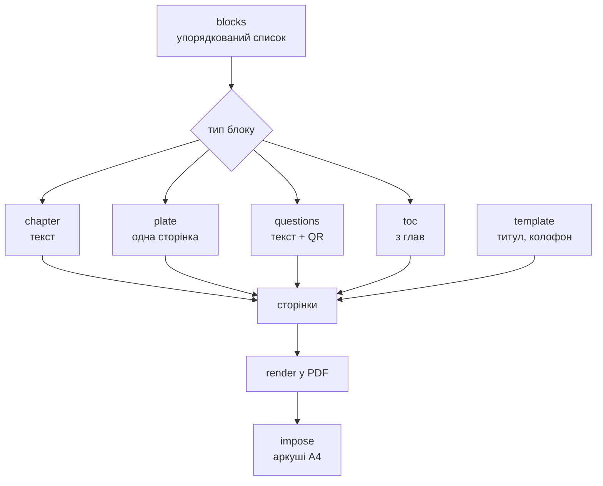

# FANCRAFT© — ТЗ

Sep 22, 2026 · @Someone

Браузерний редактор, що готує рукопис до друку на офісному Ч/Б лазері й ручного складання книги без обрізу. Без бази даних, без сервера.

## Технологічний стек

Усе виконується в браузері, без сервера й без бази даних. Бандл — близько 400 КБ плюс шрифт.

| Шар | Бібліотека | Чому саме вона |
| --- | --- | --- |
| Оболонка | Vite + React, PWA | статичний хостинг, десктоп і мобайл з однієї кодової бази |
| Редактор структури | Tiptap (ProseMirror) з урізаною схемою | семантичне дерево замість HTML; дозволено рівно ті вузли, що є в моделі |
| Метрики шрифту | fontkit | ширини гліфів і кернінг-пари для розбивки рядків |
| Переноси | hypher + словники uk, ru | єдиний спосіб отримати щільний набір на смузі 112 мм |
| Верстка | власний модуль | чиста функція, \~600–1000 рядків, без залежностей |
| PDF | pdf-lib | drawText, drawSvgPath, embedPage, сабсетинг шрифтів |
| QR | qrcode-generator → drawSvgPath | вектор замість растру |
| Архів проєкту | fflate | zip у кілька десятків кілобайт коду |
| Важкі обчислення | Web Worker | верстка й експорт не блокують інтерфейс |

### Чого свідомо не беремо

**Typst / LaTeX у WASM** — справжні рушії верстки, але кілька мегабайт бандла, чужа мова розмітки посередині пайплайну й ризик з пам'яттю на iOS. При фіксованій палітрі стилів їхня потужність не потрібна.

**Paged.js плюс браузерний «Друк у PDF»** — поля залежать від браузера, шрифти вбудовуються непередбачувано, iOS Safari не дає керованого експорту.

**Серверний рендер** — суперечить умові «без бази, у браузері» й тягне за собою хостинг, черги та ліміти.

**Будь-яку бібліотеку спуску** — потрібний випадок один і вміщується у два десятки рядків.

## Архітектура

Програма складається з **двох половин, які майже не знають одна про одну**.

| Половина | Що робить |
| --- | --- |
| **Редактор** | розмітка тексту по главах і блоках |
| **Видавець** | блоки → сторінки → аркуші → PDF |

Міст між ними один — кнопка «Експорт». Редактор нічого не знає про поля, кеглі, зошити й аркуші; видавець нічого не знає про інтерфейс. Поміж ними лежить модель, і більше нічого.

Звідси головний наслідок для розробки: редактор стає повністю робочим **до того, як з'явиться рушій верстки**. Щойно модель зафіксована, дві половини можна будувати в будь-якому порядку і не втручатись одна в одну.

Друга половина — чиста функція `блоки → PDF`. Усе нижче в цьому розділі стосується її.

Книжка — **один упорядкований список блоків**. Порядок у списку і є порядком у книжці. Прив'язок, якорів і посилань між блоками немає — ілюстрація стоїть там, де лежить у списку.



Кожен тип блоку має власну маленьку функцію `toPages(block) → Page[]`. Розбивач рядків у них спільний — і він, як і раніше, **не знає ні про зображення, ні про QR, ні про типи блоків**. Він міряє гліфи й повертає рядки; усе решта — обгортки навколо нього.

Додати п'ятий тип блоку пізніше означатиме одну нову функцію й один новий `case`. Це головна перевага списку перед потоком із якорями.

### Два наслідки, на яких тримається простота

**Прев'ю — це сам PDF.** Відмова від WYSIWYG знімає екранний рендерер цілком: готовий файл показується у вбудованому переглядачі через blob URL. Точність стовідсоткова, додаткового коду немає.

**Перерахунок не мусить бути миттєвим.** Верстка йде в воркері з дебаунсом 300 мс і індикатором. Це знімає вимоги до продуктивності рушія — його можна писати прямолінійно.

## Модель даних

Проєкт — список блоків, шаблон і короткий набір налаштувань. Жодне поле не описує вигляд сторінки.

```json
{
  "version": 1,
  "meta": { "title": "", "author": "", "year": "" },

  "settings": {
    "sheet": "A4",
    "font": "literata",
    "bodySize": 11,
    "sheetsPerSignature": 5
  },

  "blocks": [
    { "id": "b1", "type": "toc",
      "title": "Зміст" },

    { "id": "b2", "type": "chapter",
      "title": "День перший",
      "body": [
        { "type": "paragraph", "runs": [
            { "text": "", "b": false, "i": false, "s": false } ] },
        { "type": "heading", "runs": [] }
      ] },

    { "id": "b3", "type": "plate",
      "asset": "img/a7f3c1.jpg",
      "title": "",
      "caption": "",
      "side": "auto" },

    { "id": "b4", "type": "questions",
      "title": "Що спитати в цієї книжки",
      "items": [ "", "" ],
      "url": "https://…",
      "note": "" },

    { "id": "b5", "type": "tabula_rasa",
      "title": "",
      "count": 2,
      "side": "auto" }
  ],

  "template": {
    "titlePage": { "logo": "vec/logo.svg", "qr": null },
    "colophon":  { "logo": null, "qr": "https://…" }
  }
}
```

### Що тут важливо

Формат книжки **не зберігається**. Зберігається формат аркуша, а сторінка є рівно його половиною. Без обрізу інакше й бути не може.

Немає полів, інтерліньяжу, розмірів заголовків і розмірів ілюстрацій. Усе це похідне від формату та обраного кегля.

У блока немає номера сторінки й немає позиції — тільки місце в списку. Щоб пересунути ілюстрацію в інше місце книжки, достатньо перетягнути картку вище або нижче.

`id` у блока потрібен лише інтерфейсу — для ключів у списку та відміни дії. Модель на нього ніде не посилається.

## Типи блоків

П'ять типів, кожен із власною `toPages`. Усі починаються з нової сторінки — блоки ніколи не ділять сторінку між собою.

| Тип | Вміст | Сторінок | Починається |
| --- | --- | --- | --- |
| `chapter` | заголовок + текст | скільки треба | з правої |
| `plate` | заголовок + фото + опис | рівно одна | `side` |
| `questions` | заголовок + перелік + QR | 1–2 | з нової |
| `toc` | генерується з глав | 1–2 | з правої |
| `tabula_rasa` | нічого | `count` | `side` |

### chapter

Єдиний блок із власним внутрішнім потоком: абзаци, підзаголовки, накреслення. Правила верстки діють усередині блоку і ніколи не перетікають у сусідній.

**Заголовок вирішує, як блок починається.**

| Заголовок | Починається | У змісті |
| --- | --- | --- |
| є | з нової правої | так |
| немає | з наступної вільної сторінки | ні |

Звідси береться **примусовий розрив сторінки**: «Розділити блок тут» ріже картку надвоє, друга половина лишається без заголовка й йде з наступної сторінки. Глава читається суцільно, а розрив стоїть там, де ви його поставили.

Окремого елемента «розрив сторінки» усередині тексту немає і не буде. Список блоків уже вміє все, що він робив би, а один такий елемент за рік притягне «а можна ще розрив без розриву».

### plate

Зображення завжди на цілу сторінку, без розміру й без обтікання. `side` — `auto`, `recto` або `verso`; за потреби перед нею вставляється порожня сторінка.

### questions

Перелік питань до книжки та QR, що веде на її **текст для ШІ**: читач сканує, завантажує текст у будь-яку модель і ставить ці або свої питання.

Звідси слідує новий вихід програми — **`book.txt`**, чистий текст книжки, зібраний із тих самих блоків. Програма готує його разом із PDF; куди його покласти й який URL вписати в `url` — справа користувача. Сервера це не потребує: програма лише малює код із вписаного посилання.

Це гарна річ: книжка виходить у двох тілах одночасно — паперовому й машинному, і друге не коштує нічого, бо текст уже є в моделі.

### toc

Мітка місця, а не вміст. Зміст складається автоматично з заголовків `chapter` і їхніх номерів сторінок; вводити нічого не треба.

Оскільки зміст сам займає сторінки й тим зсуває нумерацію, яку показує, пагінація йде двічі: перший раз із зарезервованим місцем, другий — із підставленими номерами. Це єдине місце в програмі, де проходів два.

### tabula\_rasa

Навмисно порожні сторінки: щоб написати від руки, вклеїти знімок, лишити тиші між частинами.

| Поле | Значення |
| --- | --- |
| `count` | скільки сторінок, від однієї |
| `side` | `auto`, `recto`, `verso` — як у полоси |
| `title` | необов'язковий, друкується лише на першій |

Колонцифра на них не друкується — на цих сторінках пишуть. Римська позначка лишається: вона належить аркушу, а не вмісту.

**Два різні види порожнечі.** Пагінація й сама вставляє порожні сторінки — щоб розділ почався з правої, щоб добити зошит до кратності чотирьом. Ті не існують у моделі й з'являються при розрахунку. `tabula_rasa` — блок, який поставили ви.

На папері вони однакові, але в статистиці книги рахуються окремо: «6 порожніх, з них 2 навмисні». Інакше неможливо зрозуміти, чи все гаразд із версткою.

Розлініювання поки не робимо. Тонкі сірі лінії лазер віддає растром і вони стають брудними, а чорні 0,25 pt надто голосні для сторінки, де пишуть від руки. Якщо знадобиться — це одне поле `guide` і десяток рядків, але спершу варто спробувати чистий аркуш.

## Формат, геометрія та типографіка

Аркуш складається навпіл одним фальцем. Сторінка дорівнює половині аркуша, поля — 12 % ширини сторінки з усіх боків.

| Аркуш | Сторінка | Поля | Смуга | Кегль / інтерліньяж (дефолт) | Знаків у рядку |
| --- | --- | --- | --- | --- | --- |
| A3 | A4 | 25 мм | 160 × 247 мм | 13 / 17 pt | \~72 |
| **A4** | **A5** | **18 мм** | **112 × 174 мм** | **11 / 14,5 pt** | **\~60** |
| A5 | A6 | 13 мм | 79 × 124 мм | 9 / 12 pt | \~54 |

Реально тестується й підтримується лише шлях **A4 → A5**. Інші два лишаються в пресетах, бо коштують по три числа: A6 вимагає подачі A5, на якій більшість офісних лазерників жує папір, A4 — A3-принтера.

### Шрифт і кегль

Гарнітура й кегль — **єдиний вибір у проєкті**, зроблений один раз і чинний на всю книжку. Це два поля в `settings`, і більше налаштувань верстки немає.

- **гарнітура** — з короткого списку, що йде разом із програмою: 3–4 шрифти з повною кирилицею й ліцензією на вбудовування;
- **кегль** — 9–14 pt із кроком 0,5; формат підставляє дефолт (11 pt на A5);
- чотири накреслення: пряме, напівжирне, курсив, напівжирний курсив. Перекреслення малюється лінією.

Від обраного кегля **похідне все інше**: інтерліньяж 1,32 × кегль, розміри заголовків як множники, усі вертикальні відступи в рядках. Одне число задає весь ритм книжки.

Поруч із вибором кегля показується наслідок — скільки знаків лягає в рядок. 11 pt на A5 дає \~60, 14 pt — \~47. Це не попередження, а число, яке видно під час вибору.

Обраний шрифт **копіюється в архів проєкту**. Один і той самий файл TTF використовується і для вимірів через fontkit, і для вбудовування в PDF — інакше метрики екрана й друку розійдуться.

### Вертикальний ритм

Усі вертикальні відступи задаються **в рядках, не в міліметрах**. «Заголовок — два рядки згори, один знизу» працює на всіх форматах без перерахунку.

Наслідок — базова сітка з'являється сама: на просвіт рядки лиця й звороту лягають один в один. На тонкому офісному папері це помітно.

## Правила пагінації

Усі правила працюють мовчки. Програма нічого не питає й ні про що не попереджає.

| Ситуація | Дія |
| --- | --- |
| Початок розділу | з нової правої сторінки; порожня ліва вставляється за потреби |
| Менше двох рядків абзацу на сторінці | сторінка закінчується на рядок раніше |
| Після заголовка менше двох рядків тексту | заголовок переїздить на наступну сторінку |
| Заголовок в останньому рядку | те саме |

Перші два правила можливі тому, що низ смуги не мусить збігатися на всіх сторінках. Класична верстка воює з висячими рядками складними засобами саме через це обмеження; тут його немає.

### Один прохід, без ітерацій

Вставка полоси або порожньої сторінки зсуває все наступне й може перекинути наступний розділ з правої на ліву. Наївна реалізація тут або зациклюється, або дає помилку на одиницю.

Рішення: **один прохід від початку до кінця з лічильником сторінок.** Кожен елемент приймає рішення, знаючи лише поточну парність, і ніколи не переглядає попередні. Вставки тільки додають уперед, тож збіжність гарантована.

### Зміст

Зміст генерується після пагінації з розділів і заголовків — вводити нічого не треба. Переліку ілюстрацій немає.

Сам зміст займає сторінки й тому впливає на нумерацію, яку сам показує. Тому пагінація йде двічі: перший раз з зарезервованим місцем під зміст, другий — з підставленими номерами. Це єдине місце, де проходів два.

## Ілюстрації

Ілюстрація завжди займає **цілу сторінку**. У неї немає розміру, масштабу й обтікання — це три поля, яких немає ні в моделі, ні в інтерфейсі.

Без обтікання верстка лишається одним лінійним проходом. Це не естетичний компроміс, а несуча конструкція: обтікання перетворює розбивку на задачу зі зворотним зв'язком.

### Розміщення

| Поле | Значення |
| --- | --- |
| місце | позиція картки в списку блоків |
| `side` | `recto` — завершує прочитане; `verso` — відкриває наступне; `auto` — найближча вільна |

Зображення вписується в смугу по більшій стороні, в ті самі поля, що й текст. Зображення «під зріз» неможливе: без обрізу лишиться нерівна біла смуга недрукованої зони принтера.

Але є стеля збільшення — **не більше 200 %**, тобто не нижче 150 dpi на відбитку. Якщо вписування в смугу опустило б роздільність нижче, зображення друкується меншим і **центрується на сторінці**.

Фото на 300 px: повна смуга вимагала б ≈660 px, тож воно ставиться на 200 % — 50,8 мм завширшки — і стоїть посеред сторінки.

Пікселі при цьому **не домальовуються**. Файл лишається на 300 px, змінюється лише розмір, у якому він покладений на сторінку. Інтерполяція не додала б жодної деталі, а вагу збільшила б учетверо.

Мала світлина посеред великої сторінки читається як наклеєний відбиток — для рукотворної книжки це гідний вигляд, а не аварійний режим. Підпис під нею тримає ширину зображення, але не вужче половини смуги (56 мм).

Центрування **оптичне**: блок піднімається на 2–3 % висоти смуги вище геометричного центру. Піднімається саме композиція «зображення + підпис», а не зображення окремо.

### Підпис

Заголовок і опис необов'язкові.

- ширина підпису = ширина зображення, не смуги;
- вирівнювання по лівому краю зображення — обидва, без винятків;
- заголовок — кегль тексту, напівжирний; опис — на 2 pt менше, курсив;
- між зображенням і заголовком — один рядок, між заголовком і описом — нуль.

Якщо композиція не влізає — **зменшується зображення, ніколи не текст**. Рушій для цього викликає той самий розбивач рядків на вужчій колонці; нової машинерії не потрібно.

### Вимоги до файлів

При імпорті зображення **зменшується до 2000 px по ширині**, якщо воно більше. Це єдина обробка в програмі.

| Крок | Значення |
| --- | --- |
| Зменшення при імпорті | до 2000 px по ширині |
| Повна смуга A5 | ≈1330 px = 300 dpi |
| Поріг центрування | ≈660 px = 150 dpi |
| Стеля збільшення | 200 % |

2000 px із запасом покривають повну смугу: на 112 мм це понад 450 dpi — більше, ніж лазер відтворює. Запас лишається на формат A4.

Зменшення означає перекодування, тож у програмі з'являється одна цифра — **якість JPEG 0,9**. Вище — марно, нижче — видно на великих рівних тонах. Робиться через `canvas.drawImage` і `toBlob` — п'ятнадцять рядків, без бібліотек.

Колір, контраст і гамма не чіпаються. У сірий переводить драйвер принтера при друці. Готувати світлину — справа користувача, до імпорту.

## Службові елементи сторінки

Нижня лінія сторінки несе два елементи на одній базовій лінії, близько 9 мм нижче смуги. Верхнього колонтитула немає.

|  | Ліва сторінка | Права сторінка |
| --- | --- | --- |
| Зовнішній край | колонцифра | колонцифра |
| Внутрішній край | — | римська позначка |

Обидва вирівняні по межах текстової смуги, а не по краю паперу. Тому зсув дуплексу на них не впливає: смуга зсувається ціликом разом із ними.

### Колонцифра

9 pt, та сама гарнітура, мінускульні цифри якщо є.

Не друкується на: полосних ілюстраціях, порожніх сторінках, титулі, колофоні, першій сторінці розділу. Але **нумерація їх рахує** — це має бути в рушії явно, інакше помилка вилізе аж на друці.

### Римська позначка аркуша

Одна позначка на один аркуш друку, тільки з лицьового боку, тільки на правій половині. Це технологічна інформація для ручного складання, і вона не ховається.

Формат: **зошит · аркуш**, обидва римські, розділені середньою крапкою.

```
I · I     I · II     I · III     I · IV     I · V
II · I    II · II    …
```

Умова друку для сторінки `p` всередині зошита з `S` аркушів:

```
друкувати, якщо  p непарна  і  p ≤ 2S−1
номер аркуша = (p+1)/2
```

Правий бік лиця — завжди непарна сторінка з першої половини зошита. Тому окремого шару рендеру не потрібно, а дзеркалення позиції відпадає.

При 5 аркушах позначки лягають на сторінки 1, 3, 5, 7, 9 кожного зошита. Це нерівномірно за визначенням: лице аркуша завжди містить одну сторінку з початку зошита й одну з кінця.

**Набір.** Номер зошита — 9 pt, номер аркуша — 7 pt, на всю позначку розрядка близько 5 %. Різниця кеглів розводить `I · II` і `II · I`, які інакше дзеркаляться — а це найймовірніша помилка при складанні. Вага також збігається з порядком роботи: спершу знайти зошит, потім аркуш у ньому.

Сірим не друкувати: дрібний сірий текст лазер відтворює растром і він стає брудною плямою.

## Титул, колофон, лого і QR

Це не частина потоку. `frontMatter` і `backMatter` — маленькі власні макети з двох-трьох слотів кожен, і редагуються на окремому екрані.

Логіка слотів відрізняється від усього іншого в програмі:

- позиція абсолютна, не в потоці;
- розмір у міліметрах, не у відсотках смуги;
- тільки вектор.

### Лого

Приймається SVG, малюється контурами через `drawSvgPath`. Лого, покладене растром на 300 dpi, на лазері видно одразу — краї стають ватними. Вектор віддається на повні 600–1200 dpi принтера.

### QR

Зберігається **URL і розмір, не картинка**. Код генерується при експорті векторно — модулі як прямокутники.

Три наслідки: код ідеально чіткий за будь-якого розміру; у проєкті лежить двадцять байтів замість файлу; посилання можна виправити, не перемальовуючи.

### Назва та знак

Проєкт називається **FANCRAFT©** — мала «s» наприкінці замальована знаком копірайту. Простим текстом — імена файлів, заголовок вікна, manifest PWA — пишеться `FANCRAFTs`.

Знак живе в `vec/` як SVG і підставляється в слот титулу чи колофона на загальних правилах — окремої логіки не потребує. Це знак програми, не книжки: у видання він потрапляє лише тоді, коли користувач сам його туди ставить.

### Складальний аркуш

Окрема сторінка **поза книжкою**, друкується першою за бажанням: формат, кількість аркушів, розклад зошитів із римськими позначками, розмір останнього зошита. Виводиться з моделі, вводити нічого не треба.

## Зошити та режими експорту

Один фальц, дві сторінки A5 на альбомній A4, без повороту на 180°.

### Порядок сторінок

Для зошита з `N` сторінок, аркуш `i` (з нуля):

```
лице:   [ N − 2i , 1 + 2i ]
зворот: [ 2 + 2i , N − 1 − 2i ]
```

Це весь спуск. Міток різу, bleed, ліній фальцу немає — книжка не обрізається, а ручне складання «край до краю» точніше за складання по надрукованій лінії.

### Роздільник зошитів

Сторінки доповнюються порожніми до кратності чотирьом, потім заповнюються максимальні зошити по 5 аркушів. **Останній зошит береться найменший, у який влізає залишок** — 2 або 3 аркуші.

Приклад: 106 сторінок → 5 зошитів по 20 сторінок і один на 8, всього 2 порожні сторінки. При жорстких 5 аркушах було б 14.

### Три режими — одна функція

Порядок сторінок рахується один раз, різниця лише в групуванні.

| Режим | Вихід | Групування |
| --- | --- | --- |
| Дуплекс | один PDF | Л0, З0, Л1, З1, … |
| Двопрохідний | два PDF | Л0, Л1, … і З0, З1, … |
| Чернетка | один PDF | спуск вимкнено, порядок читання |

У двопрохідному — тумблер «зворотний порядок зворотів» (залежить від того, чи принтер складає стос лицем догори чи донизу) і тумблер «зворот повернутий на 180°». Обидва — по одному `.reverse()`, і обидва економлять пачку паперу на здогадки.

Чернетка обов'язкова: вичитувати текст за зошитним порядком неможливо. Римські позначки в ній не друкуються — там немає аркушів.

Поруч із PDF експорт віддає **`book.txt`** — чистий текст книжки для ШІ, зібраний із тих самих блоків: заголовки глав, текст, підписи до ілюстрацій. Без верстки, без номерів сторінок, без переносів.

### Кольорові аркуші окремо

Блок друкується Ч/Б на лазері, а сторінки з ілюстраціями — на кольоровому принтері. Тому експорт віддає **два PDF замість одного**.

Ділити доводиться не сторінками, а **аркушами**: на одному A4 лежать чотири сторінки книжки, і якщо хоч одна з них — полоса, увесь аркуш йде в кольоровий друк. Текст на ньому надрукується теж кольоровим принтером — він чорний, тож виглядає нормально.

| Файл | Що всередині |
| --- | --- |
| `book-mono.pdf` | аркуші без жодної ілюстрації |
| `book-color.pdf` | аркуші, де є хоч одна |

Об'єднання двох файлів — уся книжка, перетину немає.

**Тут окупається римська позначка.** Аркуші з двох стосів складаються в один за номерами: I, II — з лазера, III — з кольорового, IV, V — знову з лазера. Без позначок два стоси довелося б зводити вручну, розглядаючи вміст.

Кількість кольорових аркушів видно в статистиці й вона оновлюється, щойно ви пересуваєте ілюстрацію або міняєте `side`. Дві полоси іноді потрапляють на один аркуш — тоді кольорових аркушів на один менше. Це видно одразу, і цим можна керувати.

Режим друку — дуплекс чи двопрохідний — застосовується до обох файлів однаково: кольоровий аркуш теж має зворот.

Дві практичні речі. Папір має бути один і той самий для обох стосів, інакше блок відчувається нерівним на дотик. І струминний принтер на звичайному офісному папері жолобить аркуш — без обрізу це помітно посеред зошита, тож варто взяти щільніший папір на всю книжку, а не лише на кольорові аркуші.

У налаштуваннях експорту — тумблер «розділити кольорові аркуші». Вимкнений — один файл, як досі.

### Друк

У PDF ставиться `/PrintScaling /None`, а в інтерфейсі експорту — явне нагадування друкувати в фактичному розмірі. Найчастіша причина зіпсованого зошита — драйвер у режимі «Вписати на сторінку».

Невелика зміна масштабу не критична: драйвери масштабують відносно центру аркуша, тож фальц лишається по центру. Звідси жорстке правило для рушія: **нічого не позиціонувати від краю аркуша** — усе від центру та від меж смуги.

Зсув дуплексу 0,5–1,5 мм приймається як допустимий: при полях 18 мм він не читається. Калібрування не потрібне.

Повзучість (creep) — **завжди нуль**. Компенсація має сенс лише перед обрізом; без гільйотини вона зсуне текст і лишить сходинку на передньому краї на місці. База відліку — лінія фальцу.

## Імпорт тексту

Розмітка тексту по главах — головний функціонал редактора. Сценаріїв два.

### Сценарій 1 — автор складає книжку сам

«+ Глава» у структурі, текст вставляється у праве вікно. Розбивати нічого не треба — структура з'являється разом із текстом.

### Сценарій 2 — приходить готовий текст

`.docx`, `.md`, `.txt`, `.pdf` або вставка з буфера. Програма пробує розбити сама, а якщо не вийшло — пропонує зробити це руками.

**Один зразок, а не оцінка кожного рядка.** Програма перебирає готові зразки й рахує, скільки збігів дає кожен:

| Зразок | Приклад |
| --- | --- |
| явна мітка | `###` окремим рядком |
| розрив сторінки з `.docx` | — |
| слово + номер | `Глава 1`, `Розділ II` |
| самий номер | `I.`, `7.`, `— 3 —` |
| роздільник | `* * *`, `———` |
| короткий самотній рядок | до 60 знаків, без крапки |
| великі літери або жирний | `ДЕНЬ ПЕРШИЙ` |

Перемагає **один** зразок — той, що дає найбільше послідовних збігів, — і застосовується тільки він. Змішувати не можна: якщо книжка розмічена «Глава N», то короткі самотні рядки всередині глав — це не межі, а вигуки в діалозі.

Нагорі — один рядок замість сорока запитань:

```
Зразок: «Глава N» · знайдено 24 межі    [змінити ▾]
```

### Розрив глави в тексті

Якщо зразок не знайдено або він не підійшов, увесь текст лягає в **одну главу**, і ви ріжете його руками прямо в текстовому вікні. Дві дії, один код:

| Дія | Коли зручно |
| --- | --- |
| **Розділити тут** — по курсору, миттєво | кілька правок |
| **Розбити за мітками** — ставите `###` скрізь, потім одна дія | книжка на 200 сторінок |

Зворотна дія — **Об'єднати з наступною** — обов'язкова. Завдяки їй імпорт може собі дозволити бути приблизним: і недоріз, і переріз лагодяться потім, без повторного завантаження.

Перший рядок після розрізу стає заголовком, якщо він короткий і стоїть окремо. Інакше заголовок лишається порожнім — а така глава просто починається з наступної сторінки й не йде у зміст. Невдале автовизначення дає не помилку, а тихий розрив.

Запасний шлях для тексту без жодної структури — щоденника, збірки нотаток: «розбити кожні N знаків».

### Що чистить імпорт

- усі інлайнові стилі, крім bold / italic / strike;
- порожні абзаци, подвійні пробіли, табуляції, пробіли на кінцях рядків;
- м'які переноси й ручні розриви рядків — переноси рахує рушій;
- лапки й тире нормалізуються до типографських.

Окремо про PDF: `pdf.js` віддає найбрудніший текст із усіх джерел — колонтитули, номери сторінок, переноси на кінцях рядків. Імпорт має викидати рядки, що повторюються на багатьох сторінках, і самотні числа. Навіть тоді PDF завжди вимагатиме ручної правки.

Google Docs — через експорт у `.docx` або звичайне копіювання. Прямий доступ потребував би сервера.

## Інтерфейс

Два вікна. Ліворуч — структура, праворуч — текст обраного блоку.

| Вікно | Що в ньому |
| --- | --- |
| **Структура** | упорядкований список блоків: глави, ілюстрації, питання, зміст, порожні |
| **Текст** | вміст обраного блоку |

Рядок структури несе тип, заголовок і — щойно з'явиться рушій верстки — діапазон сторінок:

```
Глава        День перший           с. 24–38
Ілюстрація   Причал                  с. 39
Глава        (без назви)            с. 40–46
Порожні      2 сторінки              с. 47–48
```

У структурі: додати, перетягнути, перейменувати, видалити. Порядок рядків і є порядком книжки.

У текстовому вікні для глави — звичайний редактор із трьома накресленнями й підзаголовками. Для інших типів — маленька форма: ілюстрація показує файл, заголовок і опис; питання — перелік і посилання.

Верстка під час редагування не показується взагалі. Прев'ю книжки — це **відкритий експортований PDF**, а не окремий режим інтерфейсу. Точність стовідсоткова, коду нуль.

### Кнопка «Експорт»

Єдиний міст до другої половини програми. Поруч із нею — усе, що стосується паперу, а не тексту: формат, кегль, аркушів у зошиті, режим друку, розділення кольорових аркушів.

Тримати ці регулятори біля експорту, а не в головному вікні, правильно з двох причин. Вони ніяк не впливають на роботу над текстом. І доки рушія верстки ще немає, редактор уже повністю робочий — просто кнопка нічого не віддає.

### Статистика книги — завжди на екрані

Статистика живе в нижньому рядку вікна й оновлюється після кожного перерахунку.

```
148 сторінок  ·  38 аркушів: 36 Ч/Б + 2 кольорові  ·  8 зошитів (7×5 + 3)  ·  6 порожніх (2 навмисні)  ·  A5
```

Доки рушія верстки немає, рядок показує лише те, що знає редактор: скільки глав і скільки знаків. Решта з'являється разом із другою половиною програми.

Найважливіші тут два числа — скільки аркушів класти в лоток і скільки з них кольорові.

Дрібниця для реалізації: зміна кегля чи формату **перераховує верстку**; зміна кількості аркушів у зошиті — ні. Друга лише перегруповує вже пораховані сторінки, тож цей регулятор має відповідати миттєво, без воркера й без дебаунсу.

### Обмеження: 10 зошитів

Ручне шиття має стелю. Блок, товщий за десяток зошитів, важко прошити рівно, і він погано розкривається.

|  |  |
| --- | --- |
| М'яка межа | 8 зошитів — статистика підсвічується |
| Жорстка межа | 10 зошитів — експорт зупиняється |
| Максимум книжки | 50 аркушів = 200 сторінок |

Це друге й останнє попередження в програмі — перше було про роздільність зображень. Обидва стосуються фізики, а не верстки, і жодне не можна виправити автоматично.

Коли межу перевищено, програма називає три важелі — вони ж три регулятори панелі: більше аркушів у зошиті, менший кегль, менший формат. Порожнього «помилка» без виходу не буває.

### Установлення

PWA: встановлюється як додаток на десктопі (Chrome, Edge, Safari) і на мобайлі («На екран «Додому»»), зі своєю іконкою й окремим вікном.

Після першого відкриття працює **повністю офлайн** — шрифт, словники переносів і весь код кешуються service worker'ом. Сервера немає, тож після встановлення мережа не потрібна взагалі.

На мобайлі реалістичні сценарії — імпорт, правка структури й перегляд; експорт працює, але друкувати зручніше з десктопа. pdf-lib — чистий JS без WASM, тож обмежень пам'яті на iOS немає.

## Проєкт і збереження

Проєкт — один файл `.zip` з власним розширенням (наприклад `.book`). Бази даних немає.

```
project.book
├─ book.json        модель (flow, plates, template, settings)
├─ img/             оригінали ілюстрацій
├─ vec/             лого та інша векторна графіка
└─ font/            гарнітура книжки
```

Шрифт лежить всередині навмисно. Без нього проєкт не відтвориться через рік з тією самою розбивкою.

### Фото живуть в архіві, не на диску

При імпорті файл **копіюється в проєкт**. Програма не зберігає шлях до теки на комп'ютері й ніколи туди не повертається: оригінал можна перейменувати, перенести чи видалити — книжка не зміниться.

У моделі лежить не шлях, а ім'я всередині архіву — `img/a7f3c1.jpg`. Ім'я генерується з хешу вмісту. Два наслідки: та сама фотографія, додана двічі, лягає в архів один раз; і жодних проблем із кирилицею, пробілами та довжиною в іменах файлів. Оригінальне ім'я зберігається окремо, лише для показу в списку ілюстрацій.

В архіві лежить **уже зменшена копія** — той самий файл, що потрапляє в PDF. Оригінал залишається у вас на диску і в архів не кладеться: дві версії одного знімка подвоїли б вагу проєкту без жодної користі для друку.

Наслідок, який варто знати: якщо колись захочете видати цю саму книжку більшим форматом, фото доведеться завантажити заново. Для A5 це ніколи не знадобиться.

**Ціна самодостатності — розмір.** Книжка з двадцятьма фото по 2 МБ дасть архів на 40 МБ. Фотографії вже стиснені, тож у zip вони кладуться без компресії (`level 0`), а стискається лише `book.json`. Так збереження лишається миттєвим.

`"version"` у `book.json` — з першого дня. Міграція старого проєкту дешева, доки є номер.

### Де це живе між сеансами

| Механізм | Роль |
| --- | --- |
| OPFS | автозбереження поточного проєкту, прозоро для користувача |
| File System Access API | «Зберегти» у той самий файл на десктопі |
| Завантаження / Share | резервний шлях на мобайлі та в Safari |

OPFS — це не тека на диску, а приватне сховище браузера, невидиме для файлового менеджера. Воно тримає повну копію проєкту разом із фото, тож закрита вкладка або розряджений ноутбук нічого не коштують. Але це страхування, а не носій: єдиний справжній носій проєкту — `.book` на диску користувача.

Завантаження: користувач вибирає один `.book`, архів розпаковується в пам'ять, зображення стають `blob:` URL для показу. Доступу до теки немає взагалі — тільки до одного вибраного файлу.

Звідси головна властивість: проєкт **самодостатній**. Файл `.book` можна перекинути на інший комп'ютер чи на телефон, відкрити — і книжка зібереться до одного рядка так само, бо все потрібне лежить усередині: текст, фото, вектор і шрифт.

## Свідомі обмеження

Це не недороблені фічі, а рішення. Кожне з них тримає рушій простим.

| Чого немає | Чому |
| --- | --- |
| WYSIWYG | прев'ю — це сам PDF, розбіжності неможливі за побудовою |
| Обтікання текстом | перетворює верстку на задачу зі зворотним зв'язком |
| Обробка зображень, крім зменшення | колір і тони не чіпаються; у сірий переводить драйвер |
| Поля, інтерліньяж, розміри заголовків | похідні від формату й обраного кегля |
| Завантаження своїх шрифтів | короткий список із правом на вбудовування |
| Різні шрифти чи кеглі всередині книжки | вибір один на весь проєкт |
| Довільні розміри сторінки | сторінка = половина аркуша, інакше неузгоджений стан |
| Попередження верстки | усе виправляється само, попереджати немає про що |
| Перелік ілюстрацій | не той характер видання |
| CMYK, PDF/X | все в RGB під Ч/Б лазер |
| Мітки різу, bleed, creep | книжка не обрізається |
| Калібрування дуплексу | поля 18 мм ховають зсув |
| Сервер, акаунти, синхронізація | проєкт — файл, і цього достатньо |

### Що перевірити першим тестовим аркушем

Три речі, які опис не доведе:

1. Читабельність римської позначки на 7 pt на відстані витягнутої руки.
2. Гамма-криву на півтоновій ілюстрації — кожен лазер забиває середні тони по-своєму.
3. Напрямок перегортання дуплексу — тумблер «зворот на 180°» існує саме тому, що це залежить від драйвера.

## Старт у VS Code

Порядок побудований так, щоб **найважче побачити найраніше**. Рушій верстки й справжній аркуш паперу йдуть попереду інтерфейсу.

### 0. Інструменти

VS Code із розширенням Claude Code, Node LTS, Git.

Git тут не формальність. Вайбкодинг без можливості відкотитися на робочий стан перетворюється на розбір завалів: коли асистент зламає те, що вчора працювало, єдиний дешевий вихід — `git checkout`. Комміт після кожного кроку, що працює.

### 1. Каркас

```bash
npm create vite@latest fancraft -- --template react-ts
cd fancraft
npm i
npm i pdf-lib @pdf-lib/fontkit hypher hyphenation.uk hyphenation.ru fflate
npm i -D vitest
```

Комміт. Далі React не чіпаємо довго.

### 2. ТЗ у репозиторій

Покладіть цей документ у `docs/spec.md`, а в корені створіть `CLAUDE.md` — правила, які асистент не має права порушувати:

```markdown
# FANCRAFTs

Три незалежні структури: flow, plates, template. Не змішувати.
Рушій верстки нічого не знає про зображення.
Вертикальні відступи — у рядках, ніколи в міліметрах.
Нічого не позиціонувати від краю аркуша.
Зображення не обробляються — вкладаються як є.
Один шрифт і один кегль на весь проєкт.
engine/ — чисті функції, без React і без побічних ефектів.
```

Це найдешевша дія в усьому проєкті. `CLAUDE.md` читається на початку кожної сесії і саме він утримує асистента від «покращень», які ламають архітектуру.

### 3. Типи — перший код

`src/model/types.ts`: `DocModel`, `StyleSheet`, `Page`, `Plate`.

Попросіть тільки типи, без логіки. Цей файл прочитайте самі, рядок за рядком — єдиний у проєкті, де це обов'язково. Усе інше від нього похідне, і помилка тут розповзеться скрізь.

### 4. Рушій верстки — без браузера

`src/engine/layout.ts`, чиста функція `layout(doc, style, geometry) → Page[]`.

Порядок запитів до асистента: **спочатку тест, потім реалізація**. «Напиши тест: 50 абзаців, A5, 11 pt → очікую N сторінок» → переконайтеся, що тест падає → «тепер реалізуй». Інакше ви дізнаєтеся лише, що код написаний, а не що він працює.

### 5. Перший PDF

`src/pdf/render.ts` — `Page[]` → pdf-lib.

Маленький скрипт `scripts/demo.ts`, який пише `out.pdf` на диск. Запустіть, відкрийте, подивіться. Інтерфейсу досі немає, а сторінка вже є.

### 6. Спуск і папір

`src/pdf/impose.ts` — формула порядку сторінок і `embedPage`.

Тест перевіряє **масив порядку**, а не PDF: для 20 сторінок очікуємо `[20,1] [2,19] [18,3] …`.

Потім надрукуйте один зошит на справжньому папері, складіть, прошийте. Це має статися саме тут, а не наприкінці: якщо порядок сторінок чи напрямок дуплексу виявиться не тим, дешевше дізнатися зараз.

### 7. Тільки тепер інтерфейс

Імпорт тексту → структура → прев'ю PDF у `<iframe>`. Tiptap з'являється тут, не раніше.

### 8. Архів

fflate: збереження й завантаження `.book`. Після цього проєкт стає справжнім.

### 9. Решта

Ілюстрації, титул і колофон, PWA-маніфест, автозбереження в OPFS.

### Як розмовляти з асистентом

- **Один запит — одна задача.** «Зроби все ТЗ» дасть купу коду, який неможливо перевірити.
- **Комміт перед кожним великим запитом.** Не після — перед.
- **Дві невдалі спроби поспіль — відкат.** Не нашаровуйте виправлення на зламане.
- **Для змін у `engine/` спочатку просіть план**, а вже потім код.
- **Питайте «що ще ти зачепив»** — асистенти люблять «дорогою» правити сусідні файли.

### Чого не робити

Не починати з інтерфейсу — він найпомітніший і найменш важливий. Не тримати логіку в React-компонентах: усе, що рахує, живе в `engine/` і `pdf/` і тестується без браузера. Не відкладати друк на папері — це єдиний тест, який не бреше.
